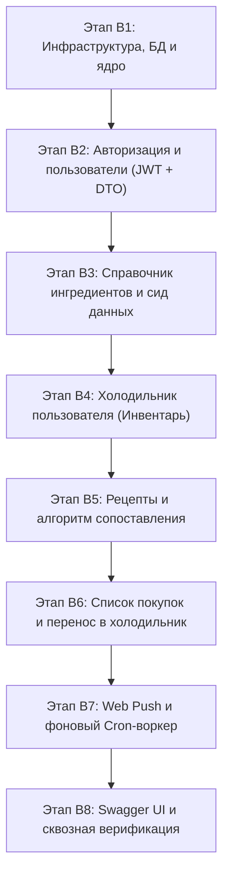
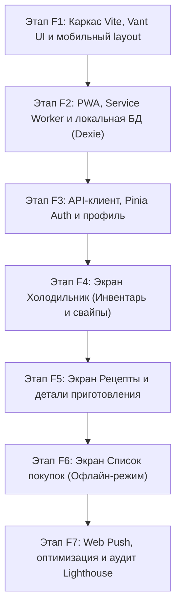

# Дорожная карта разработки WhatCook (MVP Roadmap)

В документе зафиксированы этапы разработки серверной (`backend/`) и клиентской (`frontend/`) частей приложения в строгом соответствии со скоупом MVP.

---

## ЧАСТЬ I. Backend (Golang / Gin / PostgreSQL / SQLC)

### ✅ Этап B1. Инфраструктурный фундамент и запуск сервера (Завершен)

- **Статус**: Выполнен.
- **Задачи**:
  - [x] Инициализация пула соединений PostgreSQL (`pgxpool`) с параметрами из `internal/config`.
  - [x] Генерация слоя данных через SQLC в `internal/store`.
  - [x] Базовый роутер Gin: CORS, логгер, recovery-middleware.
  - [x] Точка входа `cmd/server/main.go` с механизмом Graceful Shutdown.
  - [x] Модульные тесты с использованием `testify`.
- **Результат**: Сервер запускается, подключается к БД, эндпоинт `GET /health` возвращает `200 OK`. Тесты и `go vet` пройдены успешно.

### ✅ Этап B2. Аутентификация и пользователи (Auth &amp; Users) (Завершен)

- **Статус**: Выполнен.
- **Задачи**:
  - [x] DTO в `internal/dto/auth.go` и `user.go` (`RegisterRequest`, `LoginRequest`, `AuthResponse`, `UserResponse`, `UpdateAllergensRequest`).
  - [x] Хэширование паролей через `bcrypt`.
  - [x] Генерация короткоживущего Access Token (15 мин) и долгоживущего Refresh Token (в `HttpOnly` Cookie).
  - [x] `AuthMiddleware` для проверки заголовка `Authorization: Bearer <token>`.
  - [x] Механизм мгновенного отзыва сессий через `token_version`.
- **Эндпоинты**:
  - [x] `POST /api/v1/auth/register` — регистрация;
  - [x] `POST /api/v1/auth/login` — авторизация;
  - [x] `POST /api/v1/auth/refresh` — обновление токенов;
  - [x] `POST /api/v1/auth/logout` — выход;
  - [x] `GET /api/v1/users/me` — профиль текущего пользователя;
  - [x] `PUT /api/v1/users/me/allergens` — выбор 1 бесплатного продукта-исключения.
- **Тесты**: Модульные тесты хэширования, токенов, сервисов и middleware с использованием `testify`. Тесты и `go vet` пройдены успешно.

### ✅ Этап B3. Справочник ингредиентов (Ingredients Catalog) (Завершен)

- **Статус**: Выполнен.
- **Задачи**:
  - [x] SQLC-запросы и DTO для поиска и получения ингредиентов (`internal/dto/ingredient.go`).
  - [x] Сид-файл миграции (`000002_seed_ingredients.up.sql`) с базовым набором 75 популярных продуктов и пометкой «Базовой корзины» (`is_pantry_essential = true`).
  - [x] Быстрый поиск по подстроке (`ILIKE`) с приоритетной сортировкой для автокомплита в PWA.
- **Эндпоинты**:
  - [x] `GET /api/v1/ingredients` — каталог с поиском `?q=...` и фильтром по категории;
  - [x] `GET /api/v1/ingredients/:id` — получение информации о продукте.
- **Тесты**: Модульные тесты сервиса и хэндлеров с использованием `testify`. Тесты и `go vet` пройдены успешно.

### ✅ Этап B4. Холодильник пользователя (Fridge Inventory) (Завершен)

- **Статус**: Выполнен.
- **Задачи**:
  - [x] DTO в `internal/dto/inventory.go` (`CreateInventoryItemRequest`, `UpdateInventoryItemRequest`, `InventoryItemResponse`).
  - [x] Поддержка точного веса (`amount` + `unit`) и качественной оценки (`approximate_quantity: few | medium | much`).
  - [x] Сортировка по приближению даты порчи (`expiration_date ASC`).
- **Эндпоинты**:
  - [x] `GET /api/v1/inventory` — список продуктов в холодильнике пользователя;
  - [x] `POST /api/v1/inventory` — добавление продукта;
  - [x] `PUT /api/v1/inventory/:id` — обновление количества или срока годности;
  - [x] `DELETE /api/v1/inventory/:id` — удаление/использование продукта.
- **Тесты**: Модульные тесты сервиса и хэндлеров с использованием `testify`. Тесты и `go vet` пройдены успешно.

### ✅ Этап B5. Рецепты и алгоритм сопоставления (Recipes &amp; Matching) (Завершен)

- **Статус**: Выполнен.
- **Задачи**:
  - [x] DTO в `internal/dto/recipe.go` (`RecipeListResponse`, `RecipeResponse`, `RecipeMatchResponse`, `RecipeSyncResponse`).
  - [x] Интеграция с внешним API рецептов (TheMealDB) через интерфейс `RecipeProvider` с локализацией и кэшированием в PostgreSQL.
  - [x] Хранение шагов рецепта в JSONB, времени приготовления и уровня сложности.
  - [x] Алгоритм сопоставления:
    1. Исключение рецептов, содержащих продукт-аллерген пользователя.
    2. Базовые ингредиенты (соль, вода, масло) считаются имеющимися дома по умолчанию.
    3. Ранжирование по проценту готовности и недостающим ингредиентам.
    4. Расчет недостающих продуктов с метками критичности (🔴 `critical`, 🟡 `desirable`, 🟢 `optional`).
- **Эндпоинты**:
  - [x] `GET /api/v1/recipes/match` — подбор рецептов под текущий инвентарь холодильника;
  - [x] `GET /api/v1/recipes` — общий каталог с фильтрами по времени и сложности;
  - [x] `GET /api/v1/recipes/:id` — подробный рецепт с раскладкой «есть дома / нужно докупить»;
  - [x] `POST / DELETE /api/v1/recipes/:id/favorite` — добавление/удаление из избранного;
  - [x] `POST /api/v1/recipes/sync` — синхронизация рецептов из TheMealDB.
- **Тесты**: Модульные тесты провайдера, алгоритма подбора, сервиса и хэндлеров с использованием `testify`. Тесты и `go vet` пройдены успешно.

### ✅ Этап B6. Список покупок (Shopping List) (Завершен)

- **Статус**: Выполнен.
- **Задачи**:
  - [x] DTO в `internal/dto/shopping.go` (`ShoppingListResponse`, `ShoppingItemResponse`, `CreateShoppingItemRequest`, `UpdateShoppingItemRequest`).
  - [x] Ручное добавление позиций и пакетное добавление недостающих продуктов прямо из рецепта (`AddMissingFromRecipe`).
  - [x] Операция **«Перенести купленное в холодильник»** (`TransferToInventory` — все купленные позиции переходят в `inventory_items` с `in_stock = TRUE` и удаляются из списка покупок).
- **Эндпоинты**:
  - [x] `GET /api/v1/shopping-list` — список покупок текущего пользователя;
  - [x] `POST /api/v1/shopping-list` — добавление товара вручную;
  - [x] `POST /api/v1/shopping-list/from-recipe/:id` — добавление недостающих ингредиентов из рецепта;
  - [x] `PATCH /api/v1/shopping-list/:id` — обновление параметров и отметка товара купленным (`is_bought = true`);
  - [x] `DELETE /api/v1/shopping-list/:id` — удаление пункта;
  - [x] `POST /api/v1/shopping-list/transfer-to-inventory` — перенос купленного в холодильник.
- **Тесты**: Модульные тесты сервиса и хэндлеров с использованием `testify`. Тесты и `go vet` пройдены успешно.

### ✅ Этап B7. Web Push уведомления и фоновый воркер (Завершен)

- **Статус**: Выполнен.
- **Задачи**:
  - [x] DTO в `internal/dto/notification.go` (`SubscribeNotificationRequest`, `PushSubscriptionResponse`, `PushNotificationPayload`).
  - [x] Хранение VAPID-подписок (`push_subscriptions`) с авто-очисткой недействительных токенов (404/410).
  - [x] Фоновый воркер на Go (`ExpirationWorker`): периодически проверяет продукты с истекающим сроком (сегодня/завтра) и рассылает персонализированные Web Push уведомления через `webpush-go`.
- **Эндпоинты**:
  - [x] `POST /api/v1/notifications/subscribe` — регистрация подписки устройства;
  - [x] `GET /api/v1/notifications/subscriptions` — просмотр активных подписок пользователя.
- **Тесты**: Модульные тесты сервиса, отправки пушей, воркера и хэндлеров с использованием `testify`. Тесты и `go vet` пройдены успешно.

### ✅ Этап B8. Swagger UI и сквозная верификация (Завершен)

- **Статус**: Выполнен.
- **Задачи**:
  - [x] Swagger-аннотации во всех обработчиках (`internal/handler/*`).
  - [x] Генерация интерактивной спецификации API через `swag init` (`backend/docs/`).
  - [x] Подключение `gin-swagger` UI по адресу `/swagger/index.html`.
  - [x] Интеграционные сквозные тесты на `testify` (`internal/server/server_test.go`):
    - [x] Проверка эндпоинтов `/health`, `/swagger/index.html` и `/swagger/doc.json`;
    - [x] Полный сквозной пользовательский сценарий: Регистрация -&gt; Получение профиля -&gt; Установка аллергена -&gt; Поиск по ингредиентам -&gt; Добавление продуктов в холодильник -&gt; Умный подбор рецептов -&gt; Добавление в избранное -&gt; Перенос недостающих ингредиентов в список покупок -&gt; Отметка купленным -&gt; Перенос в холодильник -&gt; Регистрация Push-подписки -&gt; Выход.
- **Результат**: Интерактивная документация Swagger UI доступна на `/swagger/index.html`, все эндпоинты бэкенда задокументированы, сквозные тесты и линтер пройдены успешно.

---

## ЧАСТЬ II. Frontend PWA (Vue 3 / Vite / Vant UI / Pinia / Dexie.js)

### ✅ Этап F1. Инициализация проекта, стилизация и мобильный каркас (Завершен)

- **Статус**: Выполнен.
- **Задачи**:
  - [x] Инициализация `frontend/` на Vite + Vue 3 (Composition API, `<script setup>`, TypeScript) с пакетным менеджером `pnpm`.
  - [x] Подключение и настройка библиотеки **Vant UI** (готовые мобильные компоненты).
  - [x] Настройка глобального мобильного контейнера (центрирование на десктопе `max-w-[480px] mx-auto`, полноэкранный на смартфонах с поддержкой `safe-area-inset`).
  - [x] Нижняя мобильная панель навигации (`van-tabbar`): Холодильник, Рецепты, Список покупок, Профиль.
  - [x] Базовые экраны (Холодильник, Рецепты, Список покупок, Профиль) и Pinia хранилище.
  - [x] Multi-stage `Dockerfile` и конфигурация Nginx для развертывания через Docker Compose.
- **Результат**: Приложение компилируется без ошибок (`vue-tsc --noEmit && vite build`), открывается на смартфонах с удобной мобильной навигацией и safe-area-inset.

### ✅ Этап F2. Настройка PWA и локальной офлайн-базы (Dexie.js) (Завершен)

- **Статус**: Выполнен.
- **Задачи**:
  - [x] Настройка плагина `vite-plugin-pwa`: манифест приложения (`name`, `short_name`, `theme_color`, иконки 192x192, 512x512, `apple-touch-icon`, режим `standalone`, `portrait`).
  - [x] Настройка Service Worker через Workbox (кэширование статики, шрифтов, изображений и CDN-ассетов).
  - [x] Компонент `ReloadPrompt.vue` для уведомления об обновлении приложения и готовности к офлайн-работе.
  - [x] Инициализация типизированной базы данных **IndexedDB через Dexie.js** (`frontend/src/db/`):
    - Таблицы `inventory` и `shopping_list` с поддержкой гибкого учета количества и флага синхронизации.
    - Репозиторные методы CRUD для офлайн-доступа без интернета.
  - [x] Модульные тесты локальной базы данных (`vitest` + `fake-indexeddb`).
- **Результат**: Приложение генерирует Service Worker (`dist/sw.js`), манифест веб-приложения и обеспечивает автономное сохранение данных через IndexedDB.

### ✅ Этап F3. API-клиент, состояние авторизации и профиль (Завершен)

- **Статус**: Выполнен.
- **Задачи**:
  - [x] Настройка HTTP-клиента (Axios) с интерцепторами:
    - [x] Автоматическая подстановка заголовка `Authorization: Bearer <token>`;
    - [x] Перехват `401 Unauthorized` и прозрачное обновление токена через эндпоинт `/api/v1/auth/refresh`.
  - [x] Pinia Store `useAuthStore` (состояние сессии, логин, регистрация, логаут, аллергены).
  - [x] Мобильные экраны:
    - [x] Вход (`/login`) и Регистрация (`/register`) с понятной валидацией полей;
    - [x] Профиль пользователя (`/profile`) с выбором 1 бесплатного продукта-исключения (аллергии) из выпадающего списка ингредиентов.
  - [x] Защита маршрутов (`navigation guards` в Vue Router).
  - [x] Модульные тесты `useAuthStore` на `vitest`.
- **Результат**: Работает авторизация, регистрация, защищенные маршруты, автоматический refresh токенов и настройка аллергенов в профиле.

### ✅ Этап F4. Экран «Холодильник» (Инвентарь продуктов) (Завершен)

- **Статус**: Выполнен.
- **Задачи**:
  - [x] Pinia Store `useInventoryStore` с синхронизацией: IndexedDB (Dexie) &lt;-&gt; REST API.
  - [x] Компоненты экрана:
    - [x] Список продуктов с группировкой по категориям и цветовой индикацией свежести (зеленый / желтый / красный при истечении срока);
    - [x] Свайп по карточке продукта для быстрого удаления (`van-swipe-cell`);
    - [x] Мобильная шторка (`van-action-sheet` / `van-popup`) добавления продукта:
      - [x] Поле поиска с автокомплитом из справочника ингредиентов;
      - [x] Переключатель типа количества: точный вес (`amount` + `unit`) или качественная оценка («много», «средне», «мало»);
      - [x] Мобильный календарь выбора срока годности (`van-date-picker`).
    - [x] Pull-to-refresh (`van-pull-refresh`) для обновления списка с сервера.
- **Результат**: Полнофункциональный мобильный экран холодильника с поддержкой работы офлайн, индикацией сроков годности, свайпами и автодополнением продуктов.

### ✅ Этап F5. Экран «Рецепты» и умный подбор (Завершен)

- **Статус**: Выполнен.
- **Задачи**:
  - [x] Pinia Store `useRecipeStore` с интеграцией каталога, умного подбора и избранного.
  - [x] Вкладка **«Что приготовить сейчас»**:
    - [x] Список рекомендованных блюд, отсортированных по проценту совпадения продуктов;
    - [x] Бейджи «Спасает продукт!» для блюд с истекающими ингредиентами и фильтр скоропортящихся.
  - [x] Фильтры: время готовки (`<= 15 мин`, `15–30 мин`, `30–60 мин`, `> 60 мин`), сложность, строка поиска.
  - [x] **Экран детального просмотра рецепта** (`/recipes/:id`):
    - [x] Картинка, время, порции, сложность;
    - [x] Список ингредиентов, разделенный на «Есть дома» (зеленые галочки) и «Нужно купить» (с индикаторами критичности 🔴🟡🟢);
    - [x] **Кнопка в 1 клик**: «Добавить недостающие продукты в список покупок»;
    - [x] Пошаговая инструкция с таймерами готовки.
    - [x] Добавление рецепта в Избранное (кнопка-сердечко).
- **Результат**: Полноценный умный подбор рецептов на основе содержимого холодильника, учет скоропортящихся продуктов, карточки с избранным и детальный экран с таймером и быстрым добавлением недостающих ингредиентов в корзину покупок.

### ✅ Этап F6. Экран «Список покупок» (Офлайн-устойчивый) (Завершен)

- **Статус**: Выполнен.
- **Задачи**:
  - [x] Pinia Store `useShoppingStore` + IndexedDB (первоочередная работа из локального кэша для надежности в магазинах со слабой связью).
  - [x] Чекбоксы товаров с мгновенным вычеркиванием купленного.
  - [x] Группировка списка по отделам супермаркета (овощи, молочка, мясо, бакалея), чтобы пользователю не нужно было метаться по рядам магазина.
  - [x] Кнопка: **«Перенести купленное в холодильник»** (отмеченные товары отправляются в инвентарь дома одним тапом).
  - [x] Быстрое ручное добавление продуктов в список покупок.
- **Результат**: Офлайн-устойчивый мобильный список покупок с группировкой по отделам, моментальным вычеркиванием и переносом купленного в инвентарь холодильника.

### ✅ Этап F7. Web Push уведомления и финальный аудит PWA (Завершен)

- **Статус**: Выполнен.
- **Задачи**:
  - [x] Запрос разрешения на отправку браузерных уведомлений (`Notification.requestPermission()`).
  - [x] Регистрация VAPID подписки через Service Worker и отправка на бэкенд.
  - [x] Оптимизация производительности: lazy-loading маршрутов, сжатие ассетов.
  - [x] Тестирование Lighthouse: проверка критериев PWA (установка, офлайн-доступ, оценка производительности 90+).
- **Результат**: Полноценная поддержка Web Push уведомлений о сроках годности продуктов, возможность установки PWA на домашний экран (standalone) и офлайн-кэширование Workbox.

---

## ЧАСТЬ III. Доработки по итогам тестирования (Docker E2E &amp; User Feedback)

## ✅ Задача 1. Начальный сид базы рецептов и отображение каталога в Docker (Завершена)

- **Проблема**: При локальном запуске через Docker Compose в БД отсутствуют рецепты (0 записей), из-за чего на вкладке «Что приготовить» и в каталоге отображается пустой экран даже после сброса фильтров.
- **Решение**:

  
  - [x] При пустом холодильнике или отсутствии точных совпадений показывать каталог рецептов, а при сбросе фильтров отображать доступные блюда.
  - [x] При пустой базе сервер запускает начальную синхронизацию рецептов из TheMealDB.

### ✅ Задача 2. Управление «Базовой корзиной» (Pantry Essentials) (Завершена)

- **Проблема**: Базовые ингредиенты (соль, сахар, масло и т.д.) захардкожены глобально. Пользователь не может изменить состав своей базовой корзины (например, если закончилось масло или пользователь хочет добавить соевый соус/муку).
- **Решение**:
  - [x] Backend: Персональная настройка `users.pantry_ingredient_ids`, DTO и `GET/PUT /api/v1/users/me/pantry`.
  - [x] Алгоритм подбора использует персональный набор базовых продуктов.
  - [x] Frontend: интерфейс профиля с чекбоксами базовых продуктов.

### ✅ Задача 3. Множественное/серийное добавление продуктов в холодильник (Завершена)

- **Проблема**: При добавлении продукта в холодильник шторка сразу закрывается, вынуждая пользователя заново открывать форму для каждого продукта.
- **Решение**:
  - [x] В компоненте `AddProductSheet.vue` добавить режим непрерывного добавления:
    - Кнопка **«Добавить еще»** / «Добавить и продолжить»: сохраняет введенный продукт, выдает подтверждающий тост, очищает форму и оставляет шторку открытой с фокусом на поле ввода.
    - Кнопка **«Добавить и закрыть»**: сохраняет продукт и закрывает форму.
    - Опциональный переключатель «Не закрывать после добавления».

---

## ✅ Завершен: интеграция Groq LLM, оптимизация лимитов перевода и сид 73 рецептов

- **Статус**: ✅ Завершен.
- **Ветка**: `feat/b9-groq-translation-and-seed`.
- **Цель**: Интегрировать перевод через Groq LLM (OpenAI-совместимый API), настроить оптимизированное управление лимитами токенов (TPM/RPM), убрать эвристический расчёт сложности и времени, а также сгенерировать стартовый сид из 73 переведённых рецептов со всеми ингредиентами.

### Выполнено

- [x] Добавлена миграция `000004_recipe_translations`: поля локализации, состояние очереди, счётчик попыток, время следующего повтора и индекс очереди.
- [x] Обновлены SQLC-запросы: каталог, подбор, поиск и получение рецепта ограничены переведёнными рецептами; добавлены операции очереди и сохранения перевода.
- [x] Интегрирован провайдер перевода через Groq LLM с кулинарным системным промптом, выдающим реалистичные `cooking_time_minutes` и `difficulty`.
- [x] Настроен воркер перевода: лимит токенов `MaxTokens: 2500`, батчи по 3 рецепта и интервал 80 секунд под ограничение 8K TPM.
- [x] Убран эвристический расчёт сложности и времени готовки (`recipeDifficulty`) в `recipe_service.go` и `translation_service.go`.
- [x] Написан скрипт генерации сида `backend/cmd/seed_generator/main.go` с кэшированием (`seed_cache.json`) и автоподбором кандидатов по категориям TheMealDB.
- [x] Сформированы миграции `000005_seed_recipes.up.sql` и `000005_seed_recipes.down.sql` со стартовым набором из 73 полностью переведённых рецептов со всеми ингредиентами.
- [x] Обновлена версия приложения до v0.1.13 (`frontend/package.json` и `ProfileView.vue`).
- [x] Прогнаны и успешно пройдены все тесты бэкенда (`go test ./...`), линтеры (`go vet ./...`) и тесты фронтенда (`vitest run`).

---

## ✅ Завершен: Устранение дубликатов ингредиентов, оптимизация производительности и русскоязычные категории/единицы

- **Статус**: ✅ Завершен.
- **Ветка**: `feat/b10-ingredient-dedup-and-recipe-fixes`.
- **Цель**: Устранить ошибку уникального ключа `ingredients_name_key` при переводе рецептов, ускорить загрузку страниц за счёт серверной пагинации (15 рецептов) и удаления избыточных запросов, перевести поиск и сопоставление полностью на русский язык (с поддержкой поиска по ингредиентам), мигрировать категории и единицы измерения в БД на русский язык, перевести инжест рецептов воркером в батчевый режим до 1000 рецептов с переходом в режим ожидания при исчерпании TheMealDB, а также полностью удалить клиентский runtime-слой перевода.

### Выполнено

- [x] **Дедупликация ингредиентов в БД**: при переводе воркер проверяет наличие ингредиента с таким русским названием без учета регистра; перепривязывает связи `recipe_ingredients`, удаляет дублирующиеся связи и очищает неиспользуемые записи-дубликаты (`DeleteUnusedIngredient`). Запрос `UpdateIngredientRussianName` защищен от коллизий уникальности (`AND NOT EXISTS`).
- [x] **Русская таксономия в PostgreSQL**: создана миграция `000006_russian_categories_and_units` для перевода категорий («Овощи и зелень», «Мясо и птица», «Молочные продукты» и др.) и единиц измерения («г», «мл», «шт» и др.) прямо в БД.
- [x] **Серверная пагинация и поиск**:
  - Бэкенд возвращает по 15 рецептов на страницу (`limit` / `offset`), поиск по `q` ищет одновременно по названию рецепта, его русскому переводу и названиям входящих в него ингредиентов (`EXISTS ...`).
  - Добавлен отдельный оптимизированный эндпоинт `GET /api/v1/recipes/favorites`.
- [x] **Удаление клиентского слоя перевода**:
  - Полностью удалены `frontend/src/api/translation.ts` и `frontend/src/i18n/translation.ts`, удалены runtime-вызовы `displayText`, `displayUnit`, `displayIngredientName` и фолбэк-скрапинг.
  - На клиенте отображаются только переведённые рецепты, поиск работает мгновенно без перевода запроса на английский.
- [x] **Оптимизация воркера перевода и инжеста**:
  - Удалены бесплатные фолбэки (Google/MyMemory) и эндпоинт `/api/v1/translations`.
  - Воркер загружает рецепты из TheMealDB порциями по 50 штук (до лимита в 1000 рецептов) и переводит их через Groq. При исчерпании внешнего каталога воркер переходит в режим ожидания (idle).
  - При превышении суточных лимитов Groq воркер парсит время сброса квоты и засыпает до возобновления лимита.
  - Гарантирована валидация времени готовки (15-240 мин) и сложности (easy/medium/hard).
- [x] **Обновление фронтенда под серверную пагинацию**:
  - Компонент пагинации `van-pagination` переведен на серверный `totalCount` и `pageSize = 15`.
  - Поиск и фильтры по времени/сложности снабжены дебаунсом (400мс) с запросом к серверу на 1-ю страницу.
  - Поллинг статуса перевода облегчен до интервала 30с с легким запросом `limit=1`.
- [x] **Обновлена версия WhatCook**: v0.1.14 (`frontend/package.json` и `frontend/src/views/ProfileView.vue`).
- [x] **Верификация**: пройдены все тесты бэкенда (`go test ./...`), `go vet ./...`, все модульные тесты фронтенда (`pnpm test` - 33 теста), сборка PWA (`pnpm run build`).
