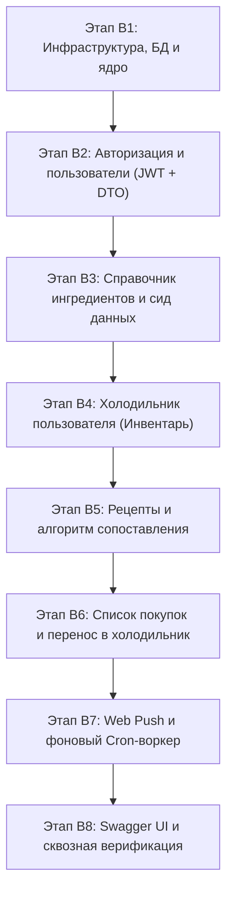
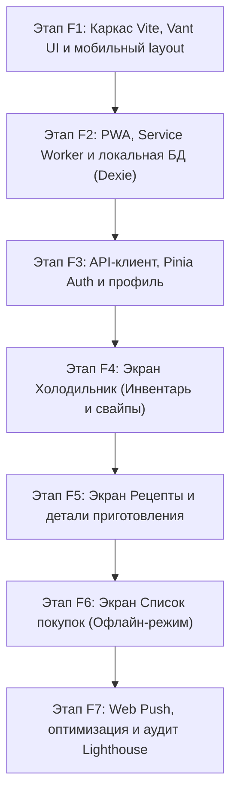

# Дорожная карта разработки WhatCook (MVP Roadmap)

В документе зафиксированы этапы разработки серверной (`backend/`) и клиентской (`frontend/`) частей приложения в строгом соответствии со скоупом MVP.

---

## ЧАСТЬ I. Backend (Golang / Gin / PostgreSQL / SQLC)

### ✅ Этап B1. Инфраструктурный фундамент и запуск сервера (Завершен)
* **Статус**: Выполнен.
* **Задачи**:
  * [x] Инициализация пула соединений PostgreSQL (`pgxpool`) с параметрами из `internal/config`.
  * [x] Генерация слоя данных через SQLC в `internal/store`.
  * [x] Базовый роутер Gin: CORS, логгер, recovery-middleware.
  * [x] Точка входа `cmd/server/main.go` с механизмом Graceful Shutdown.
  * [x] Модульные тесты с использованием `testify`.
* **Результат**: Сервер запускается, подключается к БД, эндпоинт `GET /health` возвращает `200 OK`. Тесты и `go vet` пройдены успешно.

### ✅ Этап B2. Аутентификация и пользователи (Auth & Users) (Завершен)
* **Статус**: Выполнен.
* **Задачи**:
  * [x] DTO в `internal/dto/auth.go` и `user.go` (`RegisterRequest`, `LoginRequest`, `AuthResponse`, `UserResponse`, `UpdateAllergensRequest`).
  * [x] Хэширование паролей через `bcrypt`.
  * [x] Генерация короткоживущего Access Token (15 мин) и долгоживущего Refresh Token (в `HttpOnly` Cookie).
  * [x] `AuthMiddleware` для проверки заголовка `Authorization: Bearer <token>`.
  * [x] Механизм мгновенного отзыва сессий через `token_version`.
* **Эндпоинты**:
  * [x] `POST /api/v1/auth/register` — регистрация;
  * [x] `POST /api/v1/auth/login` — авторизация;
  * [x] `POST /api/v1/auth/refresh` — обновление токенов;
  * [x] `POST /api/v1/auth/logout` — выход;
  * [x] `GET /api/v1/users/me` — профиль текущего пользователя;
  * [x] `PUT /api/v1/users/me/allergens` — выбор 1 бесплатного продукта-исключения.
* **Тесты**: Модульные тесты хэширования, токенов, сервисов и middleware с использованием `testify`. Тесты и `go vet` пройдены успешно.

### ✅ Этап B3. Справочник ингредиентов (Ingredients Catalog) (Завершен)
* **Статус**: Выполнен.
* **Задачи**:
  * [x] SQLC-запросы и DTO для поиска и получения ингредиентов (`internal/dto/ingredient.go`).
  * [x] Сид-файл миграции (`000002_seed_ingredients.up.sql`) с базовым набором 75 популярных продуктов и пометкой «Базовой корзины» (`is_pantry_essential = true`).
  * [x] Быстрый поиск по подстроке (`ILIKE`) с приоритетной сортировкой для автокомплита в PWA.
* **Эндпоинты**:
  * [x] `GET /api/v1/ingredients` — каталог с поиском `?q=...` и фильтром по категории;
  * [x] `GET /api/v1/ingredients/:id` — получение информации о продукте.
* **Тесты**: Модульные тесты сервиса и хэндлеров с использованием `testify`. Тесты и `go vet` пройдены успешно.

### ✅ Этап B4. Холодильник пользователя (Fridge Inventory) (Завершен)
* **Статус**: Выполнен.
* **Задачи**:
  * [x] DTO в `internal/dto/inventory.go` (`CreateInventoryItemRequest`, `UpdateInventoryItemRequest`, `InventoryItemResponse`).
  * [x] Поддержка точного веса (`amount` + `unit`) и качественной оценки (`approximate_quantity: few | medium | much`).
  * [x] Сортировка по приближению даты порчи (`expiration_date ASC`).
* **Эндпоинты**:
  * [x] `GET /api/v1/inventory` — список продуктов в холодильнике пользователя;
  * [x] `POST /api/v1/inventory` — добавление продукта;
  * [x] `PUT /api/v1/inventory/:id` — обновление количества или срока годности;
  * [x] `DELETE /api/v1/inventory/:id` — удаление/использование продукта.
* **Тесты**: Модульные тесты сервиса и хэндлеров с использованием `testify`. Тесты и `go vet` пройдены успешно.

### ✅ Этап B5. Рецепты и алгоритм сопоставления (Recipes & Matching) (Завершен)
* **Статус**: Выполнен.
* **Задачи**:
  * [x] DTO в `internal/dto/recipe.go` (`RecipeListResponse`, `RecipeResponse`, `RecipeMatchResponse`, `RecipeSyncResponse`).
  * [x] Интеграция с внешним API рецептов (TheMealDB) через интерфейс `RecipeProvider` с локализацией и кэшированием в PostgreSQL.
  * [x] Хранение шагов рецепта в JSONB, времени приготовления и уровня сложности.
  * [x] Алгоритм сопоставления:
    1. Исключение рецептов, содержащих продукт-аллерген пользователя.
    2. Базовые ингредиенты (соль, вода, масло) считаются имеющимися дома по умолчанию.
    3. Ранжирование по проценту готовности и недостающим ингредиентам.
    4. Расчет недостающих продуктов с метками критичности (🔴 `critical`, 🟡 `desirable`, 🟢 `optional`).
* **Эндпоинты**:
  * [x] `GET /api/v1/recipes/match` — подбор рецептов под текущий инвентарь холодильника;
  * [x] `GET /api/v1/recipes` — общий каталог с фильтрами по времени и сложности;
  * [x] `GET /api/v1/recipes/:id` — подробный рецепт с раскладкой «есть дома / нужно докупить»;
  * [x] `POST / DELETE /api/v1/recipes/:id/favorite` — добавление/удаление из избранного;
  * [x] `POST /api/v1/recipes/sync` — синхронизация рецептов из TheMealDB.
* **Тесты**: Модульные тесты провайдера, алгоритма подбора, сервиса и хэндлеров с использованием `testify`. Тесты и `go vet` пройдены успешно.

### ✅ Этап B6. Список покупок (Shopping List) (Завершен)
* **Статус**: Выполнен.
* **Задачи**:
  * [x] DTO в `internal/dto/shopping.go` (`ShoppingListResponse`, `ShoppingItemResponse`, `CreateShoppingItemRequest`, `UpdateShoppingItemRequest`).
  * [x] Ручное добавление позиций и пакетное добавление недостающих продуктов прямо из рецепта (`AddMissingFromRecipe`).
  * [x] Операция **«Перенести купленное в холодильник»** (`TransferToInventory` — все купленные позиции переходят в `inventory_items` с `in_stock = TRUE` и удаляются из списка покупок).
* **Эндпоинты**:
  * [x] `GET /api/v1/shopping-list` — список покупок текущего пользователя;
  * [x] `POST /api/v1/shopping-list` — добавление товара вручную;
  * [x] `POST /api/v1/shopping-list/from-recipe/:id` — добавление недостающих ингредиентов из рецепта;
  * [x] `PATCH /api/v1/shopping-list/:id` — обновление параметров и отметка товара купленным (`is_bought = true`);
  * [x] `DELETE /api/v1/shopping-list/:id` — удаление пункта;
  * [x] `POST /api/v1/shopping-list/transfer-to-inventory` — перенос купленного в холодильник.
* **Тесты**: Модульные тесты сервиса и хэндлеров с использованием `testify`. Тесты и `go vet` пройдены успешно.

### ✅ Этап B7. Web Push уведомления и фоновый воркер (Завершен)
* **Статус**: Выполнен.
* **Задачи**:
  * [x] DTO в `internal/dto/notification.go` (`SubscribeNotificationRequest`, `PushSubscriptionResponse`, `PushNotificationPayload`).
  * [x] Хранение VAPID-подписок (`push_subscriptions`) с авто-очисткой недействительных токенов (404/410).
  * [x] Фоновый воркер на Go (`ExpirationWorker`): периодически проверяет продукты с истекающим сроком (сегодня/завтра) и рассылает персонализированные Web Push уведомления через `webpush-go`.
* **Эндпоинты**:
  * [x] `POST /api/v1/notifications/subscribe` — регистрация подписки устройства;
  * [x] `GET /api/v1/notifications/subscriptions` — просмотр активных подписок пользователя.
* **Тесты**: Модульные тесты сервиса, отправки пушей, воркера и хэндлеров с использованием `testify`. Тесты и `go vet` пройдены успешно.

### Этап B8. Swagger UI и сквозная верификация
* **Задачи**:
  * Swagger-аннотации во всех обработчиках.
  * Генерация спецификации `task swagger:generate`.
  * Интеграционные сквозные тесты на `testify` (Регистрация -> Добавление продуктов -> Подбор рецепта -> Покупки).

---

## ЧАСТЬ II. Frontend PWA (Vue 3 / Vite / Vant UI / Pinia / Dexie.js)

### ✅ Этап F1. Инициализация проекта, стилизация и мобильный каркас (Завершен)
* **Статус**: Выполнен.
* **Задачи**:
  * [x] Инициализация `frontend/` на Vite + Vue 3 (Composition API, `<script setup>`, TypeScript) с пакетным менеджером `pnpm`.
  * [x] Подключение и настройка библиотеки **Vant UI** (готовые мобильные компоненты).
  * [x] Настройка глобального мобильного контейнера (центрирование на десктопе `max-w-[480px] mx-auto`, полноэкранный на смартфонах с поддержкой `safe-area-inset`).
  * [x] Нижняя мобильная панель навигации (`van-tabbar`): Холодильник, Рецепты, Список покупок, Профиль.
  * [x] Базовые экраны (Холодильник, Рецепты, Список покупок, Профиль) и Pinia хранилище.
  * [x] Multi-stage `Dockerfile` и конфигурация Nginx для развертывания через Docker Compose.
* **Результат**: Приложение компилируется без ошибок (`vue-tsc --noEmit && vite build`), открывается на смартфонах с удобной мобильной навигацией и safe-area-inset.

### ✅ Этап F2. Настройка PWA и локальной офлайн-базы (Dexie.js) (Завершен)
* **Статус**: Выполнен.
* **Задачи**:
  * [x] Настройка плагина `vite-plugin-pwa`: манифест приложения (`name`, `short_name`, `theme_color`, иконки 192x192, 512x512, `apple-touch-icon`, режим `standalone`, `portrait`).
  * [x] Настройка Service Worker через Workbox (кэширование статики, шрифтов, изображений и CDN-ассетов).
  * [x] Компонент `ReloadPrompt.vue` для уведомления об обновлении приложения и готовности к офлайн-работе.
  * [x] Инициализация типизированной базы данных **IndexedDB через Dexie.js** (`frontend/src/db/`):
    * Таблицы `inventory` и `shopping_list` с поддержкой гибкого учета количества и флага синхронизации.
    * Репозиторные методы CRUD для офлайн-доступа без интернета.
  * [x] Модульные тесты локальной базы данных (`vitest` + `fake-indexeddb`).
* **Результат**: Приложение генерирует Service Worker (`dist/sw.js`), манифест веб-приложения и обеспечивает автономное сохранение данных через IndexedDB.

### ✅ Этап F3. API-клиент, состояние авторизации и профиль (Завершен)
* **Статус**: Выполнен.
* **Задачи**:
  * [x] Настройка HTTP-клиента (Axios) с интерцепторами:
    * [x] Автоматическая подстановка заголовка `Authorization: Bearer <token>`;
    * [x] Перехват `401 Unauthorized` и прозрачное обновление токена через эндпоинт `/api/v1/auth/refresh`.
  * [x] Pinia Store `useAuthStore` (состояние сессии, логин, регистрация, логаут, аллергены).
  * [x] Мобильные экраны:
    * [x] Вход (`/login`) и Регистрация (`/register`) с понятной валидацией полей;
    * [x] Профиль пользователя (`/profile`) с выбором 1 бесплатного продукта-исключения (аллергии) из выпадающего списка ингредиентов.
  * [x] Защита маршрутов (`navigation guards` в Vue Router).
  * [x] Модульные тесты `useAuthStore` на `vitest`.
* **Результат**: Работает авторизация, регистрация, защищенные маршруты, автоматический refresh токенов и настройка аллергенов в профиле.

### ✅ Этап F4. Экран «Холодильник» (Инвентарь продуктов) (Завершен)
* **Статус**: Выполнен.
* **Задачи**:
  * [x] Pinia Store `useInventoryStore` с синхронизацией: IndexedDB (Dexie) <-> REST API.
  * [x] Компоненты экрана:
    * [x] Список продуктов с группировкой по категориям и цветовой индикацией свежести (зеленый / желтый / красный при истечении срока);
    * [x] Свайп по карточке продукта для быстрого удаления (`van-swipe-cell`);
    * [x] Мобильная шторка (`van-action-sheet` / `van-popup`) добавления продукта:
      * [x] Поле поиска с автокомплитом из справочника ингредиентов;
      * [x] Переключатель типа количества: точный вес (`amount` + `unit`) или качественная оценка («много», «средне», «мало»);
      * [x] Мобильный календарь выбора срока годности (`van-date-picker`).
    * [x] Pull-to-refresh (`van-pull-refresh`) для обновления списка с сервера.
* **Результат**: Полнофункциональный мобильный экран холодильника с поддержкой работы офлайн, индикацией сроков годности, свайпами и автодополнением продуктов.

### ✅ Этап F5. Экран «Рецепты» и умный подбор (Завершен)
* **Статус**: Выполнен.
* **Задачи**:
  * [x] Pinia Store `useRecipeStore` с интеграцией каталога, умного подбора и избранного.
  * [x] Вкладка **«Что приготовить сейчас»**:
    * [x] Список рекомендованных блюд, отсортированных по проценту совпадения продуктов;
    * [x] Бейджи «Спасает продукт!» для блюд с истекающими ингредиентами и фильтр скоропортящихся.
  * [x] Фильтры: время готовки (`<= 15 мин`, `15–30 мин`, `30–60 мин`, `> 60 мин`), сложность, строка поиска.
  * [x] **Экран детального просмотра рецепта** (`/recipes/:id`):
    * [x] Картинка, время, порции, сложность;
    * [x] Список ингредиентов, разделенный на «Есть дома» (зеленые галочки) и «Нужно купить» (с индикаторами критичности 🔴🟡🟢);
    * [x] **Кнопка в 1 клик**: «Добавить недостающие продукты в список покупок»;
    * [x] Пошаговая инструкция с таймерами готовки.
    * [x] Добавление рецепта в Избранное (кнопка-сердечко).
* **Результат**: Полноценный умный подбор рецептов на основе содержимого холодильника, учет скоропортящихся продуктов, карточки с избранным и детальный экран с таймером и быстрым добавлением недостающих ингредиентов в корзину покупок.

### ✅ Этап F6. Экран «Список покупок» (Офлайн-устойчивый) (Завершен)
* **Статус**: Выполнен.
* **Задачи**:
  * [x] Pinia Store `useShoppingStore` + IndexedDB (первоочередная работа из локального кэша для надежности в магазинах со слабой связью).
  * [x] Чекбоксы товаров с мгновенным вычеркиванием купленного.
  * [x] Группировка списка по отделам супермаркета (овощи, молочка, мясо, бакалея), чтобы пользователю не нужно было метаться по рядам магазина.
  * [x] Кнопка: **«Перенести купленное в холодильник»** (отмеченные товары отправляются в инвентарь дома одним тапом).
  * [x] Быстрое ручное добавление продуктов в список покупок.
* **Результат**: Офлайн-устойчивый мобильный список покупок с группировкой по отделам, моментальным вычеркиванием и переносом купленного в инвентарь холодильника.

### Этап F7. Web Push уведомления и финальный аудит PWA
* **Задачи**:
  * Запрос разрешения на отправку браузерных уведомлений (`Notification.requestPermission()`).
  * Регистрация VAPID подписки через Service Worker и отправка на бэкенд.
  * Оптимизация производительности: lazy-loading маршрутов, сжатие ассетов.
  * Тестирование Lighthouse: проверка критериев PWA (установка, офлайн-доступ, оценка производительности 90+).
