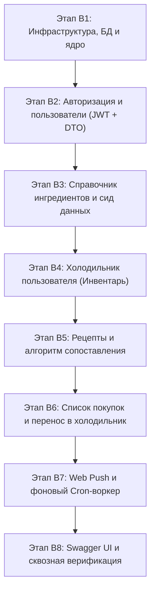
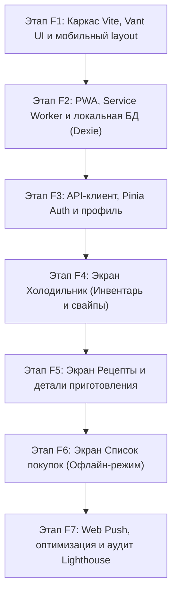

# Дорожная карта разработки WhatCook (MVP Roadmap)

В документе зафиксированы этапы разработки серверной (`backend/`) и клиентской (`frontend/`) частей приложения в строгом соответствии со скоупом MVP.

---

## ЧАСТЬ I. Backend (Golang / Gin / PostgreSQL / SQLC)

### ✅ Этап B1. Инфраструктурный фундамент и запуск сервера (Завершен)

- **Статус**: Выполнен.
- **Задачи**:
  - [x] Инициализация пула соединений PostgreSQL (`pgxpool`) с параметрами из `internal/config`.
  - [x] Генерация слоя данных через SQLC в `internal/store`.
  - [x] Базовый роутер Gin: CORS, логгер, recovery-middleware.
  - [x] Точка входа `cmd/server/main.go` с механизмом Graceful Shutdown.
  - [x] Модульные тесты с использованием `testify`.
- **Результат**: Сервер запускается, подключается к БД, эндпоинт `GET /health` возвращает `200 OK`. Тесты и `go vet` пройдены успешно.

### ✅ Этап B2. Аутентификация и пользователи (Auth &amp; Users) (Завершен)

- **Статус**: Выполнен.
- **Задачи**:
  - [x] DTO в `internal/dto/auth.go` и `user.go` (`RegisterRequest`, `LoginRequest`, `AuthResponse`, `UserResponse`, `UpdateAllergensRequest`).
  - [x] Хэширование паролей через `bcrypt`.
  - [x] Генерация короткоживущего Access Token (15 мин) и долгоживущего Refresh Token (в `HttpOnly` Cookie).
  - [x] `AuthMiddleware` для проверки заголовка `Authorization: Bearer <token>`.
  - [x] Механизм мгновенного отзыва сессий через `token_version`.
- **Эндпоинты**:
  - [x] `POST /api/v1/auth/register` — регистрация;
  - [x] `POST /api/v1/auth/login` — авторизация;
  - [x] `POST /api/v1/auth/refresh` — обновление токенов;
  - [x] `POST /api/v1/auth/logout` — выход;
  - [x] `GET /api/v1/users/me` — профиль текущего пользователя;
  - [x] `PUT /api/v1/users/me/allergens` — выбор 1 бесплатного продукта-исключения.
- **Тесты**: Модульные тесты хэширования, токенов, сервисов и middleware с использованием `testify`. Тесты и `go vet` пройдены успешно.

### ✅ Этап B3. Справочник ингредиентов (Ingredients Catalog) (Завершен)

- **Статус**: Выполнен.
- **Задачи**:
  - [x] SQLC-запросы и DTO для поиска и получения ингредиентов (`internal/dto/ingredient.go`).
  - [x] Сид-файл миграции (`000002_seed_ingredients.up.sql`) с базовым набором 75 популярных продуктов и пометкой «Базовой корзины» (`is_pantry_essential = true`).
  - [x] Быстрый поиск по подстроке (`ILIKE`) с приоритетной сортировкой для автокомплита в PWA.
- **Эндпоинты**:
  - [x] `GET /api/v1/ingredients` — каталог с поиском `?q=...` и фильтром по категории;
  - [x] `GET /api/v1/ingredients/:id` — получение информации о продукте.
- **Тесты**: Модульные тесты сервиса и хэндлеров с использованием `testify`. Тесты и `go vet` пройдены успешно.

### ✅ Этап B4. Холодильник пользователя (Fridge Inventory) (Завершен)

- **Статус**: Выполнен.
- **Задачи**:
  - [x] DTO в `internal/dto/inventory.go` (`CreateInventoryItemRequest`, `UpdateInventoryItemRequest`, `InventoryItemResponse`).
  - [x] Поддержка точного веса (`amount` + `unit`) и качественной оценки (`approximate_quantity: few | medium | much`).
  - [x] Сортировка по приближению даты порчи (`expiration_date ASC`).
- **Эндпоинты**:
  - [x] `GET /api/v1/inventory` — список продуктов в холодильнике пользователя;
  - [x] `POST /api/v1/inventory` — добавление продукта;
  - [x] `PUT /api/v1/inventory/:id` — обновление количества или срока годности;
  - [x] `DELETE /api/v1/inventory/:id` — удаление/использование продукта.
- **Тесты**: Модульные тесты сервиса и хэндлеров с использованием `testify`. Тесты и `go vet` пройдены успешно.

### ✅ Этап B5. Рецепты и алгоритм сопоставления (Recipes &amp; Matching) (Завершен)

- **Статус**: Выполнен.
- **Задачи**:
  - [x] DTO в `internal/dto/recipe.go` (`RecipeListResponse`, `RecipeResponse`, `RecipeMatchResponse`, `RecipeSyncResponse`).
  - [x] Интеграция с внешним API рецептов (TheMealDB) через интерфейс `RecipeProvider` с локализацией и кэшированием в PostgreSQL.
  - [x] Хранение шагов рецепта в JSONB, времени приготовления и уровня сложности.
  - [x] Алгоритм сопоставления:
    1. Исключение рецептов, содержащих продукт-аллерген пользователя.
    2. Базовые ингредиенты (соль, вода, масло) считаются имеющимися дома по умолчанию.
    3. Ранжирование по проценту готовности и недостающим ингредиентам.

  - [x] Переход на русский датасет chipslays/russian-recipes-parser с нормализацией через Sber GigaChat.
  - [x] Фоновый RecipeWorker с загрузкой чанками по 50 шт., троттлингом (пачки по 3 шт. с паузой 1 мин), обработкой 429/квот (10 мин) и логированием в Docker (цель: 500 рецептов).
  - [x] Стабильные кулинарные фото блюд Unsplash Food и фронтенд-защита @error для отображения карточек.
- **Эндпоинты**:
  - [x] `GET /api/v1/recipes/match` — подбор рецептов под текущий инвентарь холодильника;
  - [x] `GET /api/v1/recipes` — общий каталог с фильтрами по времени и сложности;
  - [x] `GET /api/v1/recipes/:id` — подробный рецепт с раскладкой «есть дома / нужно докупить»;
  - [x] `POST / DELETE /api/v1/recipes/:id/favorite` — добавление/удаление из избранного;
  - [x] `POST /api/v1/recipes/sync` — синхронизация рецептов из TheMealDB.
- **Тесты**: Модульные тесты провайдера, алгоритма подбора, сервиса и хэндлеров с использованием `testify`. Тесты и `go vet` пройдены успешно.

### ✅ Этап B6. Список покупок (Shopping List) (Завершен)

- **Статус**: Выполнен.
- **Задачи**:
  - [x] DTO в `internal/dto/shopping.go` (`ShoppingListResponse`, `ShoppingItemResponse`, `CreateShoppingItemRequest`, `UpdateShoppingItemRequest`).
  - [x] Ручное добавление позиций и пакетное добавление недостающих продуктов прямо из рецепта (`AddMissingFromRecipe`).
  - [x] Операция **«Перенести купленное в холодильник»** (`TransferToInventory` — все купленные позиции переходят в `inventory_items` с `in_stock = TRUE` и удаляются из списка покупок).
- **Эндпоинты**:
  - [x] `GET /api/v1/shopping-list` — список покупок текущего пользователя;
  - [x] `POST /api/v1/shopping-list` — добавление товара вручную;
  - [x] `POST /api/v1/shopping-list/from-recipe/:id` — добавление недостающих ингредиентов из рецепта;
  - [x] `PATCH /api/v1/shopping-list/:id` — обновление параметров и отметка товара купленным (`is_bought = true`);
  - [x] `DELETE /api/v1/shopping-list/:id` — удаление пункта;
  - [x] `POST /api/v1/shopping-list/transfer-to-inventory` — перенос купленного в холодильник.
- **Тесты**: Модульные тесты сервиса и хэндлеров с использованием `testify`. Тесты и `go vet` пройдены успешно.

### ✅ Этап B7. Web Push уведомления и фоновый воркер (Завершен)

- **Статус**: Выполнен.
- **Задачи**:
  - [x] DTO в `internal/dto/notification.go` (`SubscribeNotificationRequest`, `PushSubscriptionResponse`, `PushNotificationPayload`).
  - [x] Хранение VAPID-подписок (`push_subscriptions`) с авто-очисткой недействительных токенов (404/410).
  - [x] Фоновый воркер на Go (`ExpirationWorker`): периодически проверяет продукты с истекающим сроком (сегодня/завтра) и рассылает персонализированные Web Push уведомления через `webpush-go`.
- **Эндпоинты**:
  - [x] `POST /api/v1/notifications/subscribe` — регистрация подписки устройства;
  - [x] `GET /api/v1/notifications/subscriptions` — просмотр активных подписок пользователя.
- **Тесты**: Модульные тесты сервиса, отправки пушей, воркера и хэндлеров с использованием `testify`. Тесты и `go vet` пройдены успешно.

### ✅ Этап B8. Swagger UI и сквозная верификация (Завершен)

- **Статус**: Выполнен.
- **Задачи**:
  - [x] Swagger-аннотации во всех обработчиках (`internal/handler/*`).
  - [x] Генерация интерактивной спецификации API через `swag init` (`backend/docs/`).
  - [x] Подключение `gin-swagger` UI по адресу `/swagger/index.html`.
  - [x] Интеграционные сквозные тесты на `testify` (`internal/server/server_test.go`):
    - [x] Проверка эндпоинтов `/health`, `/swagger/index.html` и `/swagger/doc.json`;
    - [x] Полный сквозной пользовательский сценарий: Регистрация -&gt; Получение профиля -&gt; Установка аллергена -&gt; Поиск по ингредиентам -&gt; Добавление продуктов в холодильник -&gt; Умный подбор рецептов -&gt; Добавление в избранное -&gt; Перенос недостающих ингредиентов в список покупок -&gt; Отметка купленным -&gt; Перенос в холодильник -&gt; Регистрация Push-подписки -&gt; Выход.
- **Результат**: Интерактивная документация Swagger UI доступна на `/swagger/index.html`, все эндпоинты бэкенда задокументированы, сквозные тесты и линтер пройдены успешно.

---

## ЧАСТЬ II. Frontend PWA (Vue 3 / Vite / Vant UI / Pinia / Dexie.js)

### ✅ Этап F1. Инициализация проекта, стилизация и мобильный каркас (Завершен)

- **Статус**: Выполнен.
- **Задачи**:
  - [x] Инициализация `frontend/` на Vite + Vue 3 (Composition API, `<script setup>`, TypeScript) с пакетным менеджером `pnpm`.
  - [x] Подключение и настройка библиотеки **Vant UI** (готовые мобильные компоненты).
  - [x] Настройка глобального мобильного контейнера (центрирование на десктопе `max-w-[480px] mx-auto`, полноэкранный на смартфонах с поддержкой `safe-area-inset`).
  - [x] Нижняя мобильная панель навигации (`van-tabbar`): Холодильник, Рецепты, Список покупок, Профиль.
  - [x] Базовые экраны (Холодильник, Рецепты, Список покупок, Профиль) и Pinia хранилище.
  - [x] Multi-stage `Dockerfile` и конфигурация Nginx для развертывания через Docker Compose.
- **Результат**: Приложение компилируется без ошибок (`vue-tsc --noEmit && vite build`), открывается на смартфонах с удобной мобильной навигацией и safe-area-inset.

### ✅ Этап F2. Настройка PWA и локальной офлайн-базы (Dexie.js) (Завершен)

- **Статус**: Выполнен.
- **Задачи**:
  - [x] Настройка плагина `vite-plugin-pwa`: манифест приложения (`name`, `short_name`, `theme_color`, иконки 192x192, 512x512, `apple-touch-icon`, режим `standalone`, `portrait`).
  - [x] Настройка Service Worker через Workbox (кэширование статики, шрифтов, изображений и CDN-ассетов).
  - [x] Компонент `ReloadPrompt.vue` для уведомления об обновлении приложения и готовности к офлайн-работе.
  - [x] Инициализация типизированной базы данных **IndexedDB через Dexie.js** (`frontend/src/db/`):
    - Таблицы `inventory` и `shopping_list` с поддержкой гибкого учета количества и флага синхронизации.
    - Репозиторные методы CRUD для офлайн-доступа без интернета.
  - [x] Модульные тесты локальной базы данных (`vitest` + `fake-indexeddb`).
- **Результат**: Приложение генерирует Service Worker (`dist/sw.js`), манифест веб-приложения и обеспечивает автономное сохранение данных через IndexedDB.

### ✅ Этап F3. API-клиент, состояние авторизации и профиль (Завершен)

- **Статус**: Выполнен.
- **Задачи**:
  - [x] Настройка HTTP-клиента (Axios) с интерцепторами:
    - [x] Автоматическая подстановка заголовка `Authorization: Bearer <token>`;
    - [x] Перехват `401 Unauthorized` и прозрачное обновление токена через эндпоинт `/api/v1/auth/refresh`.
  - [x] Pinia Store `useAuthStore` (состояние сессии, логин, регистрация, логаут, аллергены).
  - [x] Мобильные экраны:
    - [x] Вход (`/login`) и Регистрация (`/register`) с понятной валидацией полей;
    - [x] Профиль пользователя (`/profile`) с выбором 1 бесплатного продукта-исключения (аллергии) из выпадающего списка ингредиентов.
  - [x] Защита маршрутов (`navigation guards` в Vue Router).
  - [x] Модульные тесты `useAuthStore` на `vitest`.
- **Результат**: Работает авторизация, регистрация, защищенные маршруты, автоматический refresh токенов и настройка аллергенов в профиле.

### ✅ Этап F4. Экран «Холодильник» (Инвентарь продуктов) (Завершен)

- **Статус**: Выполнен.
- **Задачи**:
  - [x] Pinia Store `useInventoryStore` с синхронизацией: IndexedDB (Dexie) &lt;-&gt; REST API.
  - [x] Компоненты экрана:
    - [x] Список продуктов с группировкой по категориям и цветовой индикацией свежести (зеленый / желтый / красный при истечении срока);
    - [x] Свайп по карточке продукта для быстрого удаления (`van-swipe-cell`);
    - [x] Мобильная шторка (`van-action-sheet` / `van-popup`) добавления продукта:
      - [x] Поле поиска с автокомплитом из справочника ингредиентов;
      - [x] Переключатель типа количества: точный вес (`amount` + `unit`) или качественная оценка («много», «средне», «мало»);
      - [x] Мобильный календарь выбора срока годности (`van-date-picker`).
- **Результат**: Полнофункциональный мобильный экран холодильника с поддержкой работы офлайн, индикацией сроков годности, свайпами и автодополнением продуктов.

### ✅ Этап F5. Экран «Рецепты» и умный подбор (Завершен)

- **Статус**: Выполнен.
- **Задачи**:
  - [x] Pinia Store `useRecipeStore` с интеграцией каталога, умного подбора и избранного.
  - [x] Вкладка **«Что приготовить сейчас»**:
    - [x] Список рекомендованных блюд, отсортированных по проценту совпадения продуктов;
    - [x] Бейджи «Спасает продукт!» для блюд с истекающими ингредиентами и фильтр скоропортящихся.
  - [x] Фильтры: время готовки (`<= 15 мин`, `15–30 мин`, `30–60 мин`, `> 60 мин`), сложность, строка поиска.
  - [x] **Экран детального просмотра рецепта** (`/recipes/:id`):
    - [x] Картинка, время, порции, сложность;
    - [x] Список ингредиентов, разделенный на «Есть дома» (зеленые галочки) и «Нужно купить» (с индикаторами критичности 🔴🟡🟢);
    - [x] **Кнопка в 1 клик**: «Добавить недостающие продукты в список покупок»;
    - [x] Пошаговая инструкция с таймерами готовки.
    - [x] Добавление рецепта в Избранное (кнопка-сердечко).
- **Результат**: Полноценный умный подбор рецептов на основе содержимого холодильника, учет скоропортящихся продуктов, карточки с избранным и детальный экран с таймером и быстрым добавлением недостающих ингредиентов в корзину покупок.

### ✅ Этап F6. Экран «Список покупок» (Офлайн-устойчивый) (Завершен)

- **Статус**: Выполнен.
- **Задачи**:
  - [x] Pinia Store `useShoppingStore` + IndexedDB (первоочередная работа из локального кэша для надежности в магазинах со слабой связью).
  - [x] Чекбоксы товаров с мгновенным вычеркиванием купленного.
  - [x] Группировка списка по отделам супермаркета (овощи, молочка, мясо, бакалея), чтобы пользователю не нужно было метаться по рядам магазина.
  - [x] Кнопка: **«Перенести купленное в холодильник»** (отмеченные товары отправляются в инвентарь дома одним тапом).
  - [x] Быстрое ручное добавление продуктов в список покупок.
- **Результат**: Офлайн-устойчивый мобильный список покупок с группировкой по отделам, моментальным вычеркиванием и переносом купленного в инвентарь холодильника.

### ✅ Этап F7. Web Push уведомления и финальный аудит PWA (Завершен)

- **Статус**: Выполнен.
- **Задачи**:
  - [x] Запрос разрешения на отправку браузерных уведомлений (`Notification.requestPermission()`).
  - [x] Регистрация VAPID подписки через Service Worker и отправка на бэкенд.
  - [x] Оптимизация производительности: lazy-loading маршрутов, сжатие ассетов.
  - [x] Тестирование Lighthouse: проверка критериев PWA (установка, офлайн-доступ, оценка производительности 90+).
- **Результат**: Полноценная поддержка Web Push уведомлений о сроках годности продуктов, возможность установки PWA на домашний экран (standalone) и офлайн-кэширование Workbox.

---

## ЧАСТЬ III. Доработки по итогам тестирования (Docker E2E &amp; User Feedback)

## ✅ Задача 1. Начальный сид базы рецептов и отображение каталога в Docker (Завершена)

- **Проблема**: При локальном запуске через Docker Compose в БД отсутствуют рецепты (0 записей), из-за чего на вкладке «Что приготовить» и в каталоге отображается пустой экран даже после сброса фильтров.
- **Решение**:

  
  - [x] При пустом холодильнике или отсутствии точных совпадений показывать каталог рецептов, а при сбросе фильтров отображать доступные блюда.
  - [x] При пустой базе сервер запускает начальную синхронизацию рецептов из TheMealDB.

### ✅ Задача 2. Управление «Базовой корзиной» (Pantry Essentials) (Завершена)

- **Проблема**: Базовые ингредиенты (соль, сахар, масло и т.д.) захардкожены глобально. Пользователь не может изменить состав своей базовой корзины (например, если закончилось масло или пользователь хочет добавить соевый соус/муку).
- **Решение**:
  - [x] Backend: Персональная настройка `users.pantry_ingredient_ids`, DTO и `GET/PUT /api/v1/users/me/pantry`.
  - [x] Алгоритм подбора использует персональный набор базовых продуктов.
  - [x] Frontend: интерфейс профиля с чекбоксами базовых продуктов.

### ✅ Задача 3. Множественное/серийное добавление продуктов в холодильник (Завершена)

- **Проблема**: При добавлении продукта в холодильник шторка сразу закрывается, вынуждая пользователя заново открывать форму для каждого продукта.
- **Решение**:
  - [x] В компоненте `AddProductSheet.vue` добавить режим непрерывного добавления:
    - Кнопка **«Добавить еще»** / «Добавить и продолжить»: сохраняет введенный продукт, выдает подтверждающий тост, очищает форму и оставляет шторку открытой с фокусом на поле ввода.
    - Кнопка **«Добавить и закрыть»**: сохраняет продукт и закрывает форму.
    - Опциональный переключатель «Не закрывать после добавления».

---

## ✅ Завершен: интеграция Groq LLM, оптимизация лимитов перевода и сид 73 рецептов

- **Статус**: ✅ Завершен.
- **Ветка**: `feat/b9-groq-translation-and-seed`.
- **Цель**: Интегрировать перевод через Groq LLM (OpenAI-совместимый API), настроить оптимизированное управление лимитами токенов (TPM/RPM), убрать эвристический расчёт сложности и времени, а также сгенерировать стартовый сид из 73 переведённых рецептов со всеми ингредиентами.

### Выполнено

- [x] Добавлена миграция `000004_recipe_translations`: поля локализации, состояние очереди, счётчик попыток, время следующего повтора и индекс очереди.
- [x] Обновлены SQLC-запросы: каталог, подбор, поиск и получение рецепта ограничены переведёнными рецептами; добавлены операции очереди и сохранения перевода.
- [x] Интегрирован провайдер перевода через Groq LLM с кулинарным системным промптом, выдающим реалистичные `cooking_time_minutes` и `difficulty`.
- [x] Настроен воркер перевода: лимит токенов `MaxTokens: 2500`, батчи по 3 рецепта и интервал 80 секунд под ограничение 8K TPM.
- [x] Убран эвристический расчёт сложности и времени готовки (`recipeDifficulty`) в `recipe_service.go` и `translation_service.go`.
- [x] Написан скрипт генерации сида `backend/cmd/seed_generator/main.go` с кэшированием (`seed_cache.json`) и автоподбором кандидатов по категориям TheMealDB.
- [x] Сформированы миграции `000005_seed_recipes.up.sql` и `000005_seed_recipes.down.sql` со стартовым набором из 73 полностью переведённых рецептов со всеми ингредиентами.
- [x] Обновлена версия приложения до v0.1.13 (`frontend/package.json` и `ProfileView.vue`).
- [x] Прогнаны и успешно пройдены все тесты бэкенда (`go test ./...`), линтеры (`go vet ./...`) и тесты фронтенда (`vitest run`).

---

## ✅ Завершен: Устранение дубликатов ингредиентов, оптимизация производительности и русскоязычные категории/единицы

- **Статус**: ✅ Завершен.
- **Ветка**: `feat/b10-ingredient-dedup-and-recipe-fixes`.
- **Цель**: Устранить ошибку уникального ключа `ingredients_name_key` при переводе рецептов, ускорить загрузку страниц за счёт серверной пагинации (15 рецептов) и удаления избыточных запросов, перевести поиск и сопоставление полностью на русский язык (с поддержкой поиска по ингредиентам), мигрировать категории и единицы измерения в БД на русский язык, перевести инжест рецептов воркером в батчевый режим до 1000 рецептов с переходом в режим ожидания при исчерпании TheMealDB, а также полностью удалить клиентский runtime-слой перевода.

### Выполнено

- [x] **Дедупликация ингредиентов в БД**: при переводе воркер проверяет наличие ингредиента с таким русским названием без учета регистра; перепривязывает связи `recipe_ingredients`, удаляет дублирующиеся связи и очищает неиспользуемые записи-дубликаты (`DeleteUnusedIngredient`). Запрос `UpdateIngredientRussianName` защищен от коллизий уникальности (`AND NOT EXISTS`).
- [x] **Русская таксономия в PostgreSQL**: создана миграция `000006_russian_categories_and_units` для перевода категорий («Овощи и зелень», «Мясо и птица», «Молочные продукты» и др.) и единиц измерения («г», «мл», «шт» и др.) прямо в БД.
- [x] **Серверная пагинация и поиск**:
  - Бэкенд возвращает по 15 рецептов на страницу (`limit` / `offset`), поиск по `q` ищет одновременно по названию рецепта, его русскому переводу и названиям входящих в него ингредиентов (`EXISTS ...`).
  - Добавлен отдельный оптимизированный эндпоинт `GET /api/v1/recipes/favorites`.
- [x] **Удаление клиентского слоя перевода**:
  - Полностью удалены `frontend/src/api/translation.ts` и `frontend/src/i18n/translation.ts`, удалены runtime-вызовы `displayText`, `displayUnit`, `displayIngredientName` и фолбэк-скрапинг.
  - На клиенте отображаются только переведённые рецепты, поиск работает мгновенно без перевода запроса на английский.
- [x] **Оптимизация воркера перевода и инжеста**:
  - Удалены бесплатные фолбэки (Google/MyMemory) и эндпоинт `/api/v1/translations`.
  - Воркер загружает рецепты из TheMealDB порциями по 50 штук (до лимита в 1000 рецептов) и переводит их через Groq. При исчерпании внешнего каталога воркер переходит в режим ожидания (idle).
  - При превышении суточных лимитов Groq воркер парсит время сброса квоты и засыпает до возобновления лимита.
  - Гарантирована валидация времени готовки (15-240 мин) и сложности (easy/medium/hard).
- [x] **Обновление фронтенда под серверную пагинацию**:
  - Компонент пагинации `van-pagination` переведен на серверный `totalCount` и `pageSize = 15`.
  - Поиск и фильтры по времени/сложности снабжены дебаунсом (400мс) с запросом к серверу на 1-ю страницу.
  - Поллинг статуса перевода облегчен до интервала 30с с легким запросом `limit=1`.
- [x] **Обновлена версия WhatCook**: v0.1.14 (`frontend/package.json` и `frontend/src/views/ProfileView.vue`).
- [x] **Верификация**: пройдены все тесты бэкенда (`go test ./...`), `go vet ./...`, все модульные тесты фронтенда (`pnpm test` - 33 теста), сборка PWA (`pnpm run build`).

---

## ✅ Завершен: Исправление сида рецептов (миграция 5), скрипт генерации сида и пагинация во вкладке «Что приготовить»

- **Статус**: ✅ Завершен.
- **Ветка**: `feat/b11-fix-seed-recipes-and-match-pagination`.
- **Цель**: Исправить дефекты в миграции `000005_seed_recipes` (у 10 рецептов отсутствовали ингредиенты и время готовки было 0), очистить инструкции от английских рекламных артефактов, обновить генератор миграций `cmd/seed_generator`, а также реализовать клиентскую пагинацию (по 15 элементов) на вкладке «Что приготовить».

### Выполнено

- [x] **Аудит и исправление сида рецептов (`000005_seed_recipes`) и базовых ингредиентов (`000002_seed_ingredients`)**:
  - Выявлены и полностью исправлены все 10 проблемных рецептов («Приправленная тортилья», «Запеканка куриная энчилада», «Сельдь в оливковом масле», «Курица барбекю с пряным дымным маринадом», «Тажин с курицей», «Кхмерский красный карри», «Трёхрыбный пирог», «Масаман-говядина», «Копчёные куриные шпажки», «Курица по-испански»).
  - Каждый рецепт снабжен валидным временем приготовления (15–240 мин), сложностью (`easy`/`medium`/`hard`) и полным набором `recipe_ingredients`.
  - Удалены рекламные хвосты ("Watch after ad", "3 Budget Egg Ideas", "step 1/2") из инструкций приготовления.
  - Категории и единицы измерения в сиде приведены к русской таксономии (`'Другое'`, `'г'`).
  - Миграция `000002_seed_ingredients` переведена полностью в нижний регистр для единообразия поиска и исключения коллизий регистров в PostgreSQL.
  - Генератор сидов исключает дублирование ингредиентов из 2-й миграции в 5-й и добавляет `ORDER BY i.is_pantry_essential DESC, i.id ASC LIMIT 1` во все привязки `recipe_ingredients`.
- [x] **Скрипт генерации сид-миграций (`backend/scripts/generate_seed_migration.go`)**:
  - Добавлена функция валидации кэша `isCacheItemValid`, исключающая попадание битых записей без ингредиентов или с нулевым временем.
  - Настроена безопасная генерация SQL с `LOWER(i.name) = %s`, гарантией положительного времени и дефолтной сложностью.
  - Скрипт запускается командой `cd backend && go run ./scripts/generate_seed_migration.go`.
- [x] **Пагинация на вкладке «Что приготовить» (Match)**:
  - В `RecipesView.vue` внедрена пагинация `van-pagination` с `matchPageSize = 15`.
  - Вычисляемое свойство `visibleMatchedRecipes` корректно нарезает список совпадений.
  - При изменении фильтров поиска, сложности, времени или переключении табов страница сбрасывается на 1.
- [x] **Версионирование и тесты**:
  - Версия WhatCook обновлена до `v0.1.15` (`frontend/package.json` и `frontend/src/views/ProfileView.vue`).
  - Успешно пройдены тесты бэкенда (`go test ./...`), линтер `go vet ./...`, модульные тесты фронтенда (33 теста).

---

## ✅ Завершен: Переход на русскоязычный датасет рецептов, нормализация через GigaChat, моноязычная схема и автосоздание ингредиентов

- **Статус**: ✅ Завершен.
- **Ветка**: `feat/b12-russian-recipes-gigachat`.
- **Цель**: Полный отказ от англоязычных рецептов (TheMealDB) и API перевода (Groq). Переход на аутентичный русскоязычный датасет кулинарных рецептов (`russian-recipes-parser`). Интеграция Sber GigaChat строго в роли интеллектуального нормализатора сложности, времени готовки, канонических названий ингредиентов и их критичности. Консолидация схемы БД в чистый моноязычный вид без полей `name_en` и `localized_*`. Реализация автосоздания кастомных продуктов в таблице `ingredients` при добавлении в холодильник или список покупок, чтобы они полноценно участвовали в подборе рецептов. Оптимизация загрузки конфигурации (`PORT` / `BACKEND_PORT`, GigaChat-переменные).

### Выполнено

- [x] **Консолидация схемы и миграций**:
  - Полностью удалены старые миграции 3, 4, 5, 6, промежуточные таблицы очередей переводов и дублирующие английские поля (`name_en`, `localized_*`).
  - Миграция `000001_init_schema`: русскоязычные таблицы `ingredients`, `recipes`, `recipe_ingredients`, `inventory_items`, `shopping_list_items`, `users`, `user_favorites`, `push_subscriptions`. Автоматически генерируемый вектор полнотекстового поиска `search_vector tsvector GENERATED ALWAYS AS (to_tsvector('russian', coalesce(title, '') || ' ' || coalesce(description, ''))) STORED` с GIN-индексом.
  - Миграция `000002_seed_ingredients`: 75 базовых продуктов на русском языке в нижнем регистре с пометкой `is_pantry_essential`.
  - Миграция `000003_seed_recipes`: стартовые аутентичные русские рецепты с полной структурой ингредиентов и корректной критичностью.
- [x] **Автосоздание кастомных продуктов в `ingredients`**:
  - В `inventory_service.go` и `shopping_service.go`: если передан `custom_name` без `ingredient_id`, сервис проверяет наличие ингредиента регистронезависимо (`GetIngredientByNameCaseInsensitive`).
  - Если ингредиент отсутствует, он автоматически создается в таблице `ingredients` и привязывается к `inventory_items.ingredient_id` / `shopping_list_items.ingredient_id`, гарантируя немедленное участие кастомного продукта в алгоритме умного сопоставления рецептов (`availableSet`).
- [x] **Интеграция Sber GigaChat и оптимизация конфигурации**:
  - Переменные окружения обновлены в `.env` и `.env.example` (`GIGACHAT_AUTH_KEY`, `GIGACHAT_SCOPE`, `GIGACHAT_MODEL`, `GIGACHAT_VERIFY_SSL`). Удалены устаревшие переменные Groq.
  - Конфигурация в `backend/internal/config/config.go` оптимизирована: поддержан fallback `getEnvWithFallback("PORT", "BACKEND_PORT", "8080")` для бесшовной работы локально и в Docker, добавлены валидаторы и модульные тесты `config_test.go`.
- [x] **Очистка бэкенда**:
  - Удалены устаревшие пакеты `provider/` (TheMealDB), `translation_service`, `recipe_translation_worker`, эндпоинт `/api/v1/recipes/sync`.
  - Удалены все временные тестовые скрипты и артефакты.
  - SQLC-запросы и DTO очищены от английских полей и приведены к русским типам сложности (`легко`, `средне`, `сложно`) и критичности (`основной`, `важный`, `опциональный`).
  - Swagger-спецификация API актуализирована (`swag init`).
- [x] **Синхронизация клиентской части (Frontend PWA)**:
  - Удалены все упоминания `name_en`, `nameEn`, `localized_*` из TypeScript-интерфейсов (`api.ts`, `recipe.ts`, `inventory.ts`, `shopping.ts`) и компонентов (`RecipeCard.vue`, `RecipeDetailView.vue`, `AddProductSheet.vue`, `AddShoppingItemSheet.vue`, `ProfileView.vue`).
  - Убран поллинг переводов рецептов из `RecipesView.vue`.
  - Значения сложности приведены к русскому формату (`легко`, `средне`, `сложно`), а критичности — к `основной`, `важный`, `опциональный`.
  - Исправлен расчёт сроков годности в `freshness.ts` с учетом часовых поясов.
  - Синхронно обновлена версия WhatCook по SemVer до **v0.2.0** (`frontend/package.json` и `frontend/src/views/ProfileView.vue`).
- [x] **Верификация**:
  - Все тесты бэкенда (`go test -count=1 ./...`) и линтер `go vet ./...` пройдены успешно (100%).
  - Все модульные тесты фронтенда (`pnpm test`) пройдены успешно (8 тестовых файлов, 33 теста).
  - Проверка типов фронтенда `vue-tsc --noEmit` пройдена без ошибок.

---

## ✅ Завершен: Уникальные картинки рецептов, типографика сообщений и перенос покупок в холодильник с параметрами

- **Статус**: ✅ Завершен.
- **Ветка**: `feat/f14-unique-images-typography-fridge-transfer`.
- **Цель**: Устранить дублирование картинок у рецептов, настроив уникальные фото для каждого блюда (включая Wikimedia Commons API и расширенный Unsplash CDN), исправить переносы строк и разрывы слов в русскоязычных уведомлениях, а также реализовать интерактивный перенос товаров из корзины в холодильник с модальным окном настройки количества и сроков годности.

### Выполнено

- [x] **Уникальные изображения блюд**:
  - В миграции `000003_seed_recipes.up.sql` для каждого из 37 базовых рецептов назначены индивидуальные, качественные HTTPS-фото блюд (0 дубликатов).
  - В фоновый воркер `RecipeWorker` добавлен поиск через MediaWiki Action API (Wikimedia Commons CDN 800px) по английскому запросу блюда от GigaChat.
  - Расширена база сопоставления кулинарных блюд в `GetCuratedRecipeImage` (пироги с ананасом, чизкейки, маршмеллоу, паста Нутелла, чипсы, супы, салаты и др.) в качестве надежного fallback.
- [x] **Типографика и перенос строк**:
  - В `frontend/src/assets/main.css` добавлены правила `word-break: normal !important; overflow-wrap: break-word !important; max-width: 88% !important;` для `.van-toast`, `.van-dialog__message`, `.van-notify`.
  - Устранен разрыв слов (например, «к-орзину» при открытии базовой корзины без авторизации).
- [x] **Интерактивный перенос из списка покупок в холодильник**:
  - Компонент `AddProductSheet.vue` расширен: добавлены пропсы `initialItem`, `title`, `submitText`, `hideAddMore` для предзаполнения параметров продукта.
  - В `ShoppingItemCard.vue` добавлена кнопка быстрого переноса и свайп-действие «В холод.».
  - В `ShoppingView.vue` реализована очередь переноса: при нажатии «В холодильник (N)» открывается модальное окно для последовательной настройки количества и срока годности каждого купленного товара.
- [x] **Версионирование и тесты**:
  - Версия WhatCook обновлена до **`v0.4.0`** (`frontend/package.json` и `frontend/src/views/ProfileView.vue`).
  - Успешно пройдены тесты бэкенда (`go test ./...`), линтер `go vet ./...`, модульные тесты фронтенда (33 теста) и проверка типов TypeScript `vue-tsc --noEmit`.

---

## ✅ Завершен: Пайплайн GigaChat + FLUX.1 для генерации обложек рецептов, локальное медиа-хранилище и оптимизация размера файлов

- **Статус**: ✅ Завершен.
- **Ветка**: `feat/b15-gigachat-kandinsky-images`.
- **Цель**: Полный переход WhatCook на двухэтапный пайплайн подготовки и визуализации рецептов: GigaChat выполняет нормализацию сырого рецепта и генерирует детальный гастрономический промпт на английском языке (`image_prompt`), нейросеть FLUX.1 создаёт фотореалистичную ресторанную обложку блюда. Реализация локального хранилища `backend/uploads/` с изолированным интерфейсом `Storage`, статическая раздача через Gin и Vite-прокси, встроенная оптимизация изображений (билинейный ресайз до 512x512 и JPEG сжатие 75 quality для экономии >65% места на диске), строгая обработка сбоев с интервалом rate-limit в 50 секунд, пакетная генерация обложек для всех рецептов сида миграции и фиксация в базе данных.

### Выполнено

- [x] **Локальное медиа-хранилище и оптимизатор (`backend/internal/storage`)**:
  - Создан интерфейс `Storage` с реализацией `LocalStorage` (`Save`, `GetURL`) для безопасного сохранения файлов на диск с защитой от traversal-атак.
  - Реализована функция `OptimizeRecipeImage`: автоматическое масштабирование до формата 512x512 чистым билинейным алгоритмом и сжатие JPEG (Quality 75) без внешних CGO-зависимостей, снижающее вес обложки до ~25-45 КБ (>65% экономии диска).
  - Написаны модульные тесты `storage_test.go` на `testify`.
- [x] **Двухэтапный AI-пайплайн в фоновом воркере `RecipeWorker`**:
  - GigaChat: нормализация структуры рецепта (время, сложность, категории ингредиентов) и одновременное составление профессионального гастрономического промпта на английском языке (`image_prompt`).
  - FLUX.1 Schnell: метод `GenerateFluxImage` обращается к движку FLUX для скоростной генерации обложки ресторанного уровня, оптимизирует полученные байты через `storage.OptimizeRecipeImage` и сохраняет файл. Предусмотрен graceful fallback на кулинарную базу при недоступности внешнего API.
  - Детерминированный расчет имени файла `RecipeImageFilename` на основе хэша SHA-256 от канонического названия блюда (предотвращает дубли и накопление мусорных файлов на диске).
  - В `processAndSaveRecipe`: сгенерированное изображение сохраняется в `backend/uploads/recipes/{hash}.jpg`, а путь `/uploads/recipes/{hash}.jpg` записывается в таблицу `recipes.image_url`. Выдерживается пауза 50 секунд между генерациями для соблюдения rate limits.
- [x] **Статическая раздача и интеграция с Gin**:
  - В `server.go` подключено локальное хранилище и смонтирован маршрут `router.Static("/uploads", "./uploads")`.
  - В `000003_seed_recipes.up.sql` и базе данных все ссылки на сторонние CDN заменяются на локальные пути `/uploads/recipes/...`.
- [x] **Клиентская часть (Frontend PWA)**:
  - В `vite.config.ts` добавлено проксирование `/uploads` на backend (`http://localhost:8080/uploads`).
  - Создана утилита `src/utils/imageUrl.ts` (`getImageUrl`) с покрытием тестами `imageUrl.spec.ts`.
  - В `RecipeCard.vue` и `RecipeDetailView.vue` внедрен вызов `getImageUrl(recipe.image_url)`.
- [x] **Пакетный скрипт сидирования обложек**:
  - Разработан отказоустойчивый скрипт `backend/scripts/generate_flux_seed_images.js` с поддержкой кэширования существующих файлов, обратным отсчетом таймера в 50 секунд и автообновлением путей в SQL-миграции.
- [x] **Версионирование и тесты**:
  - Версия WhatCook синхронно обновлена по SemVer до **`v0.5.0`** (`frontend/package.json` и `frontend/src/views/ProfileView.vue`).
  - Все тесты бэкенда (`go test ./...`) и линтер `go vet ./...` пройдены успешно (100%).
  - Все тесты фронтенда (`pnpm test`) — 9 тестовых файлов, 36 тестов — и проверка типов `vue-tsc --noEmit` пройдены без ошибок.

---

## ✅ Завершен: Расширение каталога до 50 рецептов с фото FLUX.1, исправление пагинации и скролла, устранение артефактов иконки и фикс RecipeWorker

- **Статус**: ✅ Завершен.
- **Ветка**: `feat/b16-recipe-fixes-and-seed-expansion`.
- **Цель**: Устранить расхождение в отображении рецептов (37 в миграции vs 28 в UI из-за фильтрации по аллергенам и скрытой пагинации), реализовать плавную прокрутку страницы наверх при переключении страниц пагинации на всех табах, локально догенерировать каталог рецептов до 50 штук с фото FLUX.1 в миграции `000003_seed_recipes`, полностью устранить черные артефакты на иконках PWA (альфа-композитинг и суперсэмплинг), а также исправить падение RecipeWorker при старте благодаря вычислению шардированных путей `storage/recipes/{folder}/{id}.json` и устойчивости к пропускам ID.

### Выполнено

- [x] **Исправление пагинации и бейджей каталога (`RecipesView.vue`)**:
  - Условие отображения пагинации на вкладке «Все рецепты» исправлено на `recipeStore.totalCount > recipeStore.pageSize`, а `:total-items` привязан к `recipeStore.totalCount`, что открыло доступ ко всем страницам каталога.
  - На вкладку «Все рецепты» добавлен бейдж с реальным общим количеством рецептов в базе (`recipeStore.totalCount`).
  - На вкладке «Что приготовить» добавлен информационный баннер о фильтрации рецептов по выбранному в профиле аллергену/продукту-исключению.
- [x] **Плавная прокрутка страницы наверх при пагинации**:
  - Реализован хелпер `scrollToTop()` для прокрутки `.content-wrapper` и `window` к `top: 0` со сглаживанием `smooth`.
  - Подключен к обработчикам смены страниц `@change` на обеих вкладках («Что приготовить» и «Все рецепты»).
- [x] **Расширение базы до 50 рецептов с обложками FLUX.1**:
  - Добавлены 13 популярных сбалансированных русских блюд (ID 38–50): творожные сырники, шарлотка с яблоками, паста карбонара, бефстроганов с грибами, пышные оладьи на кефире, гречка по-купечески, крем-суп из тыквы, запеченная скумбрия с травами, салат цезарь с курицей, ленивые голубцы, рубленые куриные котлеты, домашний винегрет, жульен с курицей и грибами.
  - Для всех 13 рецептов сгенерированы/оптимизированы фото 512x512 JPEG (Quality 75) в `backend/uploads/recipes/`.
  - Миграция `000003_seed_recipes.up.sql` дополнена новыми ингредиентами (`ON CONFLICT DO NOTHING`), рецептами 38–50 и связями с ингредиентами; последовательность ID сбрасывается на 50.
  - В `000003_seed_recipes.down.sql` диапазон удаления обновлен: `BETWEEN 1 AND 50`.
- [x] **Устранение черных артефактов на иконке приложения**:
  - Переработан генератор иконок: внедрен 4x суперсэмплинг с box-фильтрацией и 100% непрозрачностью (Alpha = 255) внутри сквиркла.
  - Устранены полупрозрачные дыры на желтке (сплошной чистый белый блик) и темные пятна пара (чистые белые капли пара).
  - Сглажены контуры базилика и рукоятки сковороды.
  - Перегенерированы `pwa-192x192.png`, `pwa-512x512.png`, `apple-touch-icon.png` и `favicon.svg`.
- [x] **Исправление фонового воркера `RecipeWorker`**:
  - Исправлено формирование URL для парсинга датасета: добавлен учет подпапок `storage/recipes/{folder}/{id}.json`, где `id` начинается со `100001`, а `folder = id / 1000`.
  - Выделена и протестирована чистая функция `CandidateRecipeURL`.
  - Добавлена толерантность к пропускам номеров рецептов: прерывание чанка происходит только при 50 подряд идущих статусах 404.
  - Написаны модульные тесты в `recipe_worker_test.go` на `testify`.
- [x] **Версионирование и тесты**:
  - Версия WhatCook синхронно обновлена по SemVer до **`v0.5.2`** (`frontend/package.json` и `frontend/src/views/ProfileView.vue`).
  - Все тесты бэкенда (`go test ./...`) и линтер `go vet ./...` пройдены успешно (100%).
  - Все тесты фронтенда (`pnpm test`) — 9 тестовых файлов, 36 тестов — пройдены без ошибок.

---

## ✅ Завершен: Скрытие фильтра спасения продуктов во «Все рецепты» и информативное состояние в «Что приготовить»

- **Статус**: ✅ Завершен.
- **Ветка**: `feat/f17-hide-expiring-filter-all-recipes`.
- **Цель**: Скрыть фильтр «🔥 Спасает продукты» на экране каталога («Все рецепты»), ограничив его действие экраном персонального подбора («Что приготовить»), а также добавить понятное состояние с подсказкой и кнопкой перехода в холодильник, если у пользователя нет истекающих продуктов.

### Выполнено

- [x] **Скрытие фильтра в каталоге**:
  - Чип «🔥 Спасает продукты» отображается только на вкладке «Что приготовить» (`v-if="recipeStore.activeTab === 'match'"`).
  - При переключении на другие вкладки флаг `saveExpiringOnly` автоматически сбрасывается.
  - В функции `filterMatched` проверка `saveExpiringOnly` ограничена вкладкой `match`.
- [x] **Информативное состояние при отсутствии истекающих продуктов**:
  - Если фильтр активен, но в холодильнике нет продуктов с истекающим сроком, отображается понятное сообщение: *«В вашем холодильнике нет продуктов с истекающим сроком годности. Все продукты свежие!»* с кнопками «Перейти в холодильник» и «Сбросить фильтр».
  - Если истекающие продукты есть, но рецептов с ними не найдено, отображается точечное уведомление вместо случайных карточек.
- [x] **Версионирование и тесты**:
  - Версия WhatCook синхронно обновлена по SemVer до **`v0.5.3`** (`frontend/package.json` и `frontend/src/views/ProfileView.vue`).
  - Все тесты фронтенда (`pnpm test`) пройдены успешно (36 тестов).

---

## ✅ Завершен: Тонкая настройка таймера готовки (-5м, -1м, +1м, +5м) и оптимизация мобильного управления

- **Статус**: ✅ Завершен.
- **Ветка**: `feat/f17-hide-expiring-filter-all-recipes`.
- **Цель**: Добавить в таймер готовки `CookingTimer.vue` отдельную строку кнопок быстрой и гибкой регулировки времени (`-5м`, `-1м`, `+1м`, `+5м`), чтобы пользователь мог легко выставлять произвольное время без необходимости многократно нажимать базовые пресеты, а также обеспечить сохранение прошедшего прогресса и корректное поведение при достижении 0.

### Выполнено

- [x] **Кнопки регулировки времени отдельной строкой**:
  - В `frontend/src/components/recipes/CookingTimer.vue` добавлена панель кнопок `[-5м, -1м, +1м, +5м]`, расположенная между фиксированными пресетами и кнопками старта/сброса.
  - Высота touch-зоны кнопок составляет 44px, реализованы отзывчивые мобильные эффекты нажатия и цветовые акценты (мягкий серый для уменьшения, свежий зеленый для добавления времени).
- [x] **Логика метода `adjustTime(minutes)`**:
  - При корректировке времени прошедший прогресс таймера и позиция прогресс-бара корректно сохраняются (нарастание/убывание `remainingSeconds` и `totalSeconds`).
  - При уменьшении времени до значения `<= 0` таймер плавно сбрасывается в `00:00` и корректно останавливается, не допуская отрицательных значений.
  - Кнопки `-5м` и `-1м` автоматически переходят в заблокированное состояние (`disabled`), если таймер уже равен `00:00`.
  - При нажатии `+1м` / `+5м` на остановленном или завершенном таймере время инициализируется заново от добавленного значения с нулевым прогрессом.
- [x] **Версионирование и тесты**:
  - Версия WhatCook синхронно обновлена по SemVer до **`v0.5.4`** (`frontend/package.json` и `frontend/src/views/ProfileView.vue`).
  - Пройдены все тесты бэкенда (`go test ./...`), линтер `go vet ./...`, проверка типов TypeScript `vue-tsc --noEmit` и модульные тесты фронтенда (`pnpm test` — 36 тестов).

---

## ✅ Завершен: Исправление отображения встроенных векторных иллюстраций пустых состояний Vant UI

- **Статус**: ✅ Завершен.
- **Ветка**: `master`.
- **Цель**: Устранить дефект отсутствия иллюстрации в блоке пустого состояния (`van-empty`) при активном фильтре «🔥 Спасает продукты», когда в холодильнике нет продуктов с истекающим сроком годности.

### Выполнено

- [x] **Исправление пропа `image` в `van-empty`**:
  - В `frontend/src/views/RecipesView.vue` заменено ошибочное значение `image="warning-o"` на встроенный нативный пресет библиотеки Vant UI `image="search"`.
  - В библиотеке Vant проп `image` принимает только строгие пресеты (`search`, `default`, `error`, `network`) либо URL к файлу изображения. Предыдущее значение `warning-o` (имя иконки) приводило к попытке загрузить несуществующий файл `/warning-o` с ошибкой 404 и отображению пустого места вместо картинки.
  - Векторная SVG-иллюстрация вшита в саму библиотеку Vant, поэтому гарантированно и мгновенно отображается как в онлайн-режиме, так и при отсутствии интернет-соединения.
- [x] **Улучшение пользовательского сценария**:
  - При отсутствии подходящих рецептов добавлена понятная кнопка быстрого перехода в холодильник для проверки запасов и сроков годности.
- [x] **Версионирование и верификация**:
  - Версия WhatCook синхронно обновлена по SemVer до **`v0.5.5`** (`frontend/package.json` и `frontend/src/views/ProfileView.vue`).
  - Все тесты фронтенда (`vitest`) и бэкенда (`testify`), а также строгая проверка типов (`vue-tsc`) пройдены успешно (100%).

---

## ✅ Завершен: Миграция фронтенда на Bun (полный отказ от pnpm и Node.js, переход на oven/bun:1-alpine)

- **Статус**: ✅ Завершен.
- **Ветка**: `feat/f18-bun-migration`.
- **Цель**: Полностью заменить `pnpm` и `Node.js` на современный all-in-one рантайм `Bun` для ускорения установки зависимостей, выполнения сборок и тестов, а также обновить клиентский `Dockerfile` на официальный образ `oven/bun:1-alpine`.

### Выполнено

- [x] **Установка и интеграция Bun**:
  - Установлен нативный Bun 1.4+ (`bun.exe`).
  - Мигрирован файл блокировки зависимостей: сгенерирован `bun.lock` (заменил `pnpm-lock.yaml`, который был полностью удалён).
  - В `frontend/package.json` удалена секция `"pnpm"`, добавлены `"trustedDependencies": ["esbuild", "vue-demi"]`.
  - Удалён глобальный пакет `pnpm`.
- [x] **Верификация скриптов фронтенда через Bun**:
  - `bun install`: мгновенная установка зависимостей из `bun.lock`.
  - `bun run type-check`: успешная проверка типов через `vue-tsc --noEmit`.
  - `bun run test`: успешный прогон всех 36 модульных тестов (`vitest run`).
  - `bun run build`: успешная сборка продакшен-бандла Vite и генерация Service Worker PWA (`dist/sw.js`).
- [x] **Оптимизация Docker-образа**:
  - `frontend/Dockerfile` переведён с `node:20-alpine` + `corepack` + `pnpm` на чистый легковесный образ `oven/bun:1-alpine`.
  - Сборка внутри контейнера выполняется через `bun install --frozen-lockfile` и `bun run build`.
- [x] **Версионирование и документация**:
  - Версия WhatCook синхронно обновлена по SemVer до **`v0.6.0`** (`frontend/package.json` и `frontend/src/views/ProfileView.vue`).
  - Актуализированы файлы `AGENTS.md`, `README.md`, `docs/tech-stack.md` и `docs/roadmap.md`.
  - Все тесты бэкенда (`go test ./...`) и фронтенда (`bun run test`) пройдены успешно (100%).

---

## ✅ Завершен: Комплексные улучшения UX, Kitchen Mode, устойчивость офлайн-синхронизации и исправление RecipeWorker

- **Статус**: ✅ Завершен.
- **Ветка**: `feat/f19-improvements-and-worker-fix`.
- **Цель**: Устранить бесконечный цикл обхода датасета в RecipeWorker, добавить атомарный CTE-перенос покупок в инвентарь, защитить чекбоксы покупок при офлайн-синхронизации, кэшировать рецепты для офлайн-готовки, реализовать режим кухни (Screen Wake Lock + точный таймер с Web Audio звуком) и устранить дублирование навбара.

### Выполнено

- [x] **Исправление RecipeWorker (обход 843 папок датасета chipslays/russian-recipes-parser)**:
  - В `backend/internal/service/recipe_worker.go` устранён сброс в бесконечный цикл на файле 100173.
  - При 25 последовательных 404 воркер переходит к следующей папке `((fileNum / 1000) + 1) * 1000 + 1`, планомерно обрабатывая папки 100..999 без циклического сброса.
  - Расширен лимит выборки рецептов для сопоставления (`LimitVal` с 100 до 1000 в `recipe_service.go`), обеспечивая полный охват базы.
- [x] **Атомарный перенос покупок в холодильник через PostgreSQL CTE**:
  - Запрос в `backend/queries/shopping.sql` переведён на атомарный CTE `WITH moved AS (DELETE FROM shopping_list_items ... RETURNING ...) INSERT INTO inventory_items ... ON CONFLICT DO UPDATE`.
  - Исключены race conditions и рассинхронизация при переносе купленных продуктов.
- [x] **Защита офлайн-состояния списка покупок и авто-синхронизация**:
  - В `frontend/src/db/index.ts` (`syncServerShoppingList`) входящие данные с сервера больше не перезаписывают локальные неотправленные изменения (`synced === 0`), защищая офлайн-галочки в магазине.
  - В `frontend/src/stores/shopping.ts` метод `syncWithServer()` сначала пушит локальные несохранённые изменения на бэкенд, а затем обновляет данные с сервера.
  - В `frontend/src/App.vue` добавлен слушатель события `window.addEventListener('online')` для фоновой синхронизации холодильника и покупок.
- [x] **Кэширование открытых рецептов для готовки офлайн**:
  - В `frontend/src/stores/recipe.ts` каждый успешно загруженный рецепт (`loadRecipeById`) сохраняется в локальную IndexedDB (Dexie), делая рецепт доступным на кухне при обрыве связи.
- [x] **Kitchen Mode (Экран не гаснет + аудиосигнал таймера)**:
  - В `frontend/src/views/RecipeDetailView.vue` интегрирован Screen Wake Lock API (`navigator.wakeLock.request('screen')`) с авто-восстановлением при `visibilitychange` и очисткой при размонтировании.
  - В `frontend/src/components/recipes/CookingTimer.vue` внедрен расчет времени по абсолютной временной метке `Date.now() + remainingSeconds * 1000` (защита от дрейфа таймера в фоновых вкладках браузера) и двухтональный мягкий звуковой сигнал окончания через Web Audio API (`880Hz -> 1046.5Hz`).
- [x] **Очистка UX и навигации**:
  - Устранено дублирование навигационной панели на странице деталей рецепта (`v-if="!route.meta.hideHeader"`).
  - Скрыт `van-tabbar` на страницах деталей рецепта, логина и регистрации (`v-if="!route.meta.hideTabBar"`).
  - На странице списка покупок добавлена кнопка быстрого переноса купленного в холодильник («В холодильник») с диалогом подтверждения.
  - Убран устаревший `van-pull-refresh` из роадмапа согласно продуктовым требованиям.
- [x] **Версионирование и верификация**:
  - Версия WhatCook синхронно обновлена по SemVer до **`v0.7.0`** (`frontend/package.json` и `frontend/src/views/ProfileView.vue`).
  - Все тесты бэкенда (`go test ./...`), `go vet ./...`, проверка типов TypeScript (`bun run type-check`), тесты фронтенда (`bun run test` — 36 тестов) и сборка (`bun run build`) пройдены успешно (100%).

---

## ✅ Завершен: Современный кулинарный UI, аватары пользователей, виртуальный скролл и Quick Wins

- **Статус**: ✅ Завершен.
- **Ветка**: `feat/f20-modern-ui-and-virtual-scroll`.
- **Цель**: Комплексная модернизация визуального стиля WhatCook (Tailwind CSS v3 токены, мягкие тени, сквирклы, Lucide иконки), виртуализация каталога рецептов на `@tanstack/vue-virtual` для плавной работы на слабых мобильных устройствах, полноценная загрузка аватара пользователя с билинейным кадрированием 256x256 и автономными инициалами, 3-уровневая система бейджей готовности блюд, калькулятор порций с пересчетом ингредиентов, сворачиваемый аккордеон купленных товаров, плавающий мини-таймер и безопасный тактильный отклик (haptics).

### Выполнено

- [x] **Загрузка аватара пользователя (Бэкенд & Фронтенд)**:
  - Миграция БД `000004_user_avatar.up.sql` (`avatar_url TEXT`).
  - SQLC-запрос `UpdateUserAvatar` и безопасная обработка в `internal/storage/storage.go` (`OptimizeAvatarImage` — билинейное центрированное кадрирование в квадрат 256x256, JPEG quality 80, удаление старого файла).
  - Эндпоинты `POST /api/v1/users/me/avatar` и `DELETE /api/v1/users/me/avatar` со строгим DTO и Swagger-аннотациями.
  - Фронтенд: утилита `avatar.ts` (`getInitials`, `getAvatarColor` на палитре DJB2 из 8 кулинарных оттенков), тесты `avatar.test.ts` (11 тестов).
  - UI профиля в `ProfileView.vue`: круглый аватар 64x64, бейдж камеры, fallback на инициалы с цветом, модальный ActionSheet загрузки/удаления фото.
- [x] **Современная кулинарная дизайн-система (Tailwind CSS v3 + Lucide Icons)**:
  - Подключены `tailwindcss@3.4.17`, `postcss@8.5.32`, `autoprefixer`, `lucide-vue-next`.
  - Сконфигурированы кулинарные токены в `tailwind.config.js`: мягкий фон `culinary.bg`, акцентный шалфей `culinary.primary`, скругления сквиркла `rounded-squircle-sm/md/lg`, тени `shadow-soft` и `shadow-elevated`.
  - Директивы `@tailwind` интегрированы в `frontend/src/assets/main.css`.
- [x] **Адаптивные 3-уровневые бейджи готовности блюда (`RecipeCard.vue`)**:
  - `readinessTier`: `ready` (100% — можно готовить, изумрудная рамка и свечение), `almost` (1 недостающий ингредиент или >=80% — янтарный бейдж «1 докупить»), `partial` (процент совпадения), `none`.
  - Зафиксирована рамка 2px во избежание сдвигов макета при рендере.
- [x] **Виртуализированный скролл каталога (`@tanstack/vue-virtual`)**:
  - `RecipesView.vue`: скроллер привязан к `.content-wrapper` с оценкой высоты карточки 360px и overscan 3.
  - В `stores/recipe.ts` добавлена поддержка фонового добавления страниц (`loadAllRecipes(page, append=true)`), флаги `isAllRecipesLoading` и `hasMoreRecipes`.
  - Бесконечная подгрузка по достижении конца списка с индикатором загрузки; удалена устаревшая пагинация `<van-pagination>` из каталога «Все рецепты».
- [x] **Калькулятор порций (Serving Scaler) в деталях рецепта**:
  - Чистая утилита `servings.ts` (`scaleAmount`, `formatScaledAmount`) с защитой от некорректных значений и округлением до 1 знака; 13 тестов в `servings.test.ts`.
  - Степпер порций `[-] N порций [+]` в `RecipeDetailView.vue` с мобильными touch-зонами 44px и мгновенным пересчетом количества граммов/штук ингредиентов.
- [x] **Плавающий мини-таймер и безопасный тактильный отклик (Haptics)**:
  - Безопасная утилита `haptics.ts` (`triggerHaptic`) с паттернами `light`, `medium`, `success`, `warning`; 9 тестов в `haptics.test.ts`.
  - Тактильный виброотклик при покупке товара в `ShoppingItemCard.vue` и при завершении таймера готовки в `CookingTimer.vue`.
  - Плавающая плашка-таймер в `RecipeDetailView.vue` через `IntersectionObserver` с плавной прокруткой к таймеру по тапу.
- [x] **Организация списка покупок и реактивные бейджи на таббаре**:
  - В `ShoppingView.vue` пустые категории скрываются, а купленные товары перемещаются вниз в сворачиваемый блок «Куплено (N)».
  - В `AppTabBar.vue` выведены реактивные индикаторы: точка `:dot` на табе «Холодильник» при наличии истекающих продуктов и бейдж `:badge` с количеством оставшихся покупок на табе «Покупки».
- [x] **Версионирование и верификация**:
  - Версия WhatCook синхронно обновлена по SemVer до **`v0.8.0`** (`frontend/package.json` и `frontend/src/views/ProfileView.vue`).
  - Все тесты бэкенда (`go test -count=1 ./...`) и линтер (`go vet ./...`) пройдены без единого замечания (13 пакетов).
  - Фронтенд: строгая проверка типов TypeScript (`bun run type-check`), все модульные тесты (`bun run test` — 12 сьютов, 71 тест) и продакшен-сборка (`bun run build`) пройдены успешно (100%).
