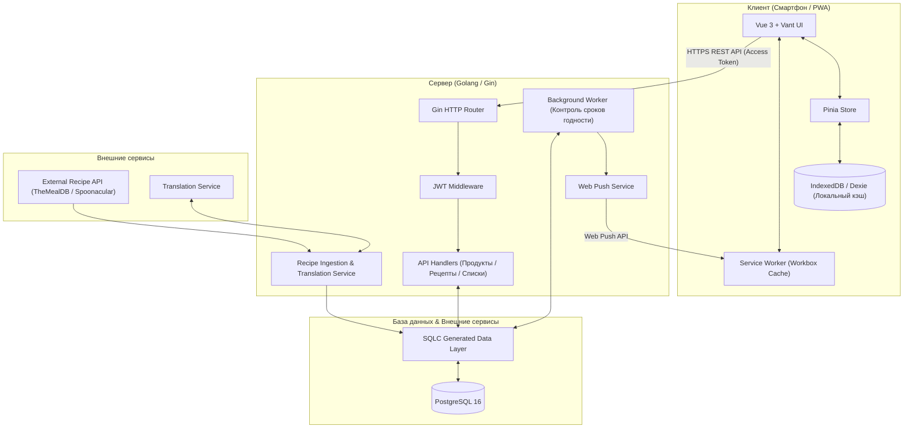

# Технологический стек проекта «Что приготовить?»

Документ фиксирует утвержденный технологический стек, архитектурные решения и детали реализации системы.

---

## 1. Концепция и форм-фактор

* **Форм-фактор**: **Mobile-First PWA (Progressive Web App)**.
  * Интерфейс проектируется в первую очередь под мобильные устройства (смартфоны).
  * Поддержка нативных мобильных паттернов: жестовое управление (свайпы по карточкам продуктов, pull-to-refresh, мобильные шторки / bottom sheets).
  * Возможность установки на домашний экран устройства без обязательной публикации в App Store / Google Play (`display: standalone`).
  * Быстрая загрузка и адаптивный мобильный интерфейс.

* **Организация кодовой базы**: **Монорепозиторий (Monorepo)**.
  * Весь исходный код проекта (клиент, сервер, миграции БД, документация, конфигурация Docker) хранится в одном репозитории.
  * Единая история изменений, атомарные коммиты (изменение API бэкенда и соответствующего экрана фронтенда выполняются в рамках одной ветки/PR).
  * Упрощенная локальная разработка: запуск всего стека одной командой через Docker Compose.

* **Сетевая модель**: **Гибридная (Online-First с поддержкой Offline-Fallback)**.
  * **Требует доступа к сети (Online)**:
    * регистрация и аутентификация пользователей;
    * синхронизация содержимого холодильника между устройствами/аккаунтами;
    * получение свежей базы рецептов и глобальный поиск;
    * отправка push-уведомлений (например, об истекающих сроках годности);
    * загрузка медиафайлов (фотографии блюд).
  * **Доступно без интернета (Offline-Fallback)**:
    * просмотр уже открытых и сохраненных рецептов (готовка на кухне при нестабильном Wi-Fi);
    * работа с текущим списком покупок (посещение супермаркета с плохой мобильной связью);
    * локальный просмотр содержимого холодильника из кэша.

---

## 2. Утвержденный технологический стек

### 2.1. Frontend (Клиент)
* **Ядро фреймворка**: **Vue 3** (Composition API, `<script setup>`).
* **Сборщик**: **Vite** (высокая скорость сборки и мгновенный Hot Module Replacement).
* **Язык**: **TypeScript** (строгая типизация данных продуктов, сроков годности и DTO ответов API).
* **Пакетный менеджер**: **pnpm** (высокая скорость установки, строгая изоляция зависимостей и экономия дискового пространства).
* **Мобильная UI-библиотека**: **Vant UI** (специализированная библиотека мобильных компонентов: выбор дат для сроков годности, свайп-ячейки `SwipeCell`, шторки `ActionSheet`, диалоги и мобильные уведомления).
* **Стейт-менеджмент**: **Pinia** (официальный модульный реактивный менеджер состояния).
* **Маршрутизация**: **Vue Router 4** (клиентский роутинг с мобильными анимациями переходов).
* **PWA & Офлайн**:
  * **`vite-plugin-pwa` (Workbox)**: генерация Service Worker, управление кэшированием ассетов и страниц, манифест веб-приложения.
  * **IndexedDB (через Dexie.js)**: структурированное локальное хранилище на устройстве для офлайн-доступа к холодильнику и списку покупок.

### 2.2. Backend (Серверная часть)
* **Язык**: **Golang (Go 1.22+)**.
  * Высокая производительность и минимальное потребление ресурсов.
  * Горутины для фоновых задач (мониторинг сроков годности продуктов, фоновая отправка уведомлений).
  * Компиляция в один бинарный файл, удобство контейнеризации в Docker.
* **Веб-фреймворк**: **Gin**.
  * Популярный, проверенный REST API фреймворк с отличной производительностью.
  * Богатая экосистема middleware (CORS, валидация запросов, JWT-авторизация, логирование).
* **Документация API**: **Swagger / OpenAPI (через `swaggo/gin-swagger`)**.
  * Автоматическая генерация интерактивной спецификации API по комментариям в Go-коде.
  * Доступ к Swagger UI (например, по адресу `/swagger/index.html`) для тестирования эндпоинтов и быстрой интеграции с фронтендом.
* **База данных**: **PostgreSQL 16+**.
  * Надежная реляционная СУБД для управления связями (пользователи, продукты, рецепты, ингредиенты, списки покупок).
  * Встроенный полнотекстовый поиск для поиска блюд по ингредиентам.
  * Поддержка `JSONB` для гибких метаданных рецептов (шаги приготовления, пищевая ценность).
* **Работа с БД**: **SQLC + pgx (драйвер)**.
  * Подход «SQL-First»: пишется чистый SQL, утилита компилирует его в типобезопасный Go-код.
  * Полный контроль над SQL-запросами, высокая производительность без накладных расходов классических ORM.
* **Миграции базы данных**: **`golang-migrate`**.
  * Управление версионированием схемы БД через парные SQL-файлы (`{version}_{name}.up.sql` и `{version}_{name}.down.sql`).
* **Хранилище медиафайлов (MVP)**: **Локальное хранилище сервера (`backend/uploads/`)**.
  * Загружаемые фотографии блюд и продуктов сохраняются на диск сервера и раздаются как статические файлы через Gin.
  * Архитектура контроллера загрузки изолируется через интерфейс (Storage Interface), чтобы в будущем при масштабировании можно было бесшовно переключиться на S3/Cloudflare R2 без переписывания бизнес-логики.
* **Уведомления**: **Web Push API (VAPID) + Cron Worker**.
  * Фоновый воркер на Go по расписанию проверяет приближение окончания сроков годности продуктов в холодильнике.
  * Отправка push-уведомлений в браузер/смартфон пользователя через библиотеку `SherClockHolmes/webpush-go`.

### 2.3. Аутентификация и безопасность
* **Механизм**: **JWT (JSON Web Tokens)** по схеме Access + Refresh.
  * **Access Token**: короткоживущий токен (15–30 минут), передается в заголовке `Authorization: Bearer <token>`.
  * **Refresh Token**: долгоживущий токен (30–60 дней), сохраняется в защищенной куке (`HttpOnly`, `Secure`, `SameSite=Lax`). Позволяет мобильному пользователю не вводить пароль повторно при каждом открытии приложения.
* **Сценарий**: Регистрация и вход по Email + пароль, с хэшированием паролей через `bcrypt` / `argon2id`.

### 2.4. Доменная логика и бизнес-правила (MVP)
* **Интеграция с внешним API рецептов**:
  * Получение базы рецептов через внешний REST API (TheMealDB / Spoonacular).
  * Фоновый сервис импорта в Go сохраняет рецепты в PostgreSQL для быстрого локального поиска и независимости от внешних лимитов.
  * Модуль перевода/локализации (через API машинного перевода или предварительно подготовленные словари) для адаптации названий и шагов на русский язык.
* **Гибкий учет остатков продуктов**:
  * Входные данные продукта поддерживают как точные значения (число `amount` + единица измерения `unit`), так и качественный ввод / флаг наличия (`in_stock: true`, остаток: «много», «средне», «мало»).
  * Это исключает раздражение пользователя от необходимости взвешивать каждый ингредиент.
* **«Базовая корзина» (Pantry Essentials)**:
  * Список продуктов, которые по умолчанию считаются имеющимися дома у каждого (соль, перец, вода, растительное масло, сахар). Они не помечаются как «недостающие» при расчете готовности рецепта.
* **Модель доступа (MVP)**:
  * Персональный инвентарь: 1 пользователь = 1 холодильник и 1 список покупок. Структура внешних ключей в базе проектируется с возможностью добавления групповых пространств (`HouseholdID`) на следующем этапе.

---

## 3. Архитектурная схема взаимодействия



---

## 4. Структура монорепозитория

Рекомендуемая базовая структура проекта:

```text
whatcook/
├── .github/                  # CI/CD воркфлоу (линтеры, тесты, сборка Docker)
├── docs/                     # Документация проекта и архитектурные схемы
│   ├── tech-stack.md
│   └── ...
├── frontend/                 # Клиентская часть (Vue 3 + Vite + Vant + PWA)
│   ├── src/
│   │   ├── api/              # Клиентские запросы к бэкенду
│   │   ├── components/       # Переиспользуемые UI-компоненты
│   │   ├── stores/           # Pinia хранилища (продукты, рецепты, auth)
│   │   ├── views/            # Экраны приложения (Холодильник, Рецепты, Список покупок)
│   │   └── ...
│   ├── public/               # PWA манифест, иконки, splash screens
│   ├── package.json
│   ├── pnpm-lock.yaml        # Блокировка версий зависимостей (pnpm)
│   └── vite.config.ts
├── backend/                  # Серверная часть (Golang / Gin)
│   ├── cmd/
│   │   └── server/           # Точка входа приложения (main.go)
│   ├── docs/                 # Сгенерированная Swagger спецификация (docs.go, swagger.json)
│   ├── internal/
│   │   ├── config/           # Чтение конфигурации окружения (.env)
│   │   ├── handler/          # HTTP контроллеры (Gin handlers)
│   │   ├── middleware/       # JWT авторизация, CORS, логгер
│   │   ├── service/          # Бизнес-логика (подбор рецептов, уведомления)
│   │   └── store/            # SQLC сгенерированный код и запросы к БД
│   ├── migrations/           # SQL миграции golang-migrate (*.up.sql, *.down.sql)
│   ├── uploads/              # Локальное хранилище фото блюд и продуктов (MVP)
│   ├── sqlc.yaml             # Конфигурация генератора SQLC
│   ├── go.mod
│   └── go.sum
├── deploy/                   # Конфигурации для деплоя и Nginx
├── docker-compose.yml        # Локальный запуск (PostgreSQL + Backend + Frontend)
├── .gitignore
└── README.md
```

---

## 5. Следующие шаги разработки

1. Создание базовой структуры папок монорепозитория (`frontend/`, `backend/`, `migrations/`).
2. Подготовка `docker-compose.yml` для локальной разработки (PostgreSQL 16 + pgAdmin/Adminer по желанию).
3. Проектирование схемы базы данных в `migrations/` и настройка генерации кода через SQLC.
4. Инициализация проекта Vue 3 с подключением Vant UI и `vite-plugin-pwa`.

