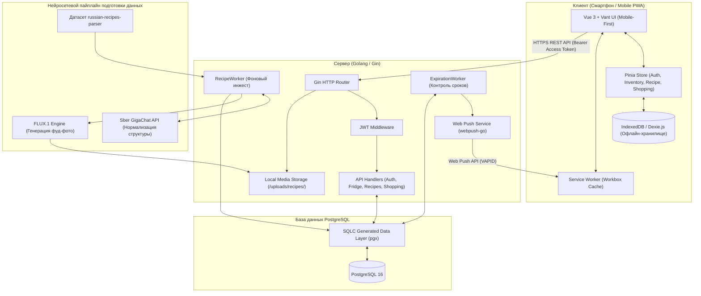

# Технологический стек проекта «Что приготовить?»

Документ фиксирует утвержденный технологический стек, архитектурные решения и детали реализации системы WhatCook.

---

## 1. Концепция и форм-фактор

* **Форм-фактор**: **Mobile-First PWA (Progressive Web App)**.
  * Интерфейс проектируется в первую очередь под мобильные устройства (смартфоны от 360px).
  * Поддержка нативных мобильных паттернов: жестовое управление (свайпы по карточкам продуктов, pull-to-refresh, мобильные шторки / bottom sheets, touch-зоны не менее 44x44px).
  * Возможность установки на домашний экран устройства без обязательной публикации в App Store / Google Play (`display: standalone`).
  * Быстрая загрузка и адаптивный мобильный интерфейс.

* **Организация кодовой базы**: **Монорепозиторий (Monorepo)**.
  * Весь исходный код проекта (клиент, сервер, миграции БД, документация, конфигурация Docker) хранится в одном репозитории.
  * Единая история изменений, атомарные коммиты (изменение API бэкенда и соответствующего экрана фронтенда выполняются в рамках одной ветки/PR).
  * Упрощенная локальная разработка: запуск всего стека одной командой через Docker Compose.

* **Сетевая модель**: **Гибридная (Online-First с поддержкой Offline-Fallback)**.
  * **Требует доступа к сети (Online)**:
    * регистрация и аутентификация пользователей;
    * синхронизация содержимого холодильника и списка покупок;
    * получение свежего каталога рецептов;
    * отправка Web Push уведомлений об истекающих сроках годности;
    * первичная загрузка медиафайлов (фотографии блюд).
  * **Доступно без интернета (Offline-Fallback)**:
    * просмотр уже открытых и сохраненных рецептов (готовка на кухне при нестабильном Wi-Fi);
    * интерактивный таймер приготовления блюд;
    * работа с текущим списком покупок (посещение супермаркета с плохой мобильной связью);
    * локальный просмотр содержимого холодильника из кэша IndexedDB.

---

## 2. Утвержденный технологический стек

### 2.1. Frontend (Клиент)
* **Ядро фреймворка**: **Vue 3** (Composition API, `<script setup>`).
* **Сборщик**: **Vite** (высокая скорость сборки и мгновенный Hot Module Replacement).
* **Язык**: **TypeScript** (строгая типизация данных продуктов, сроков годности и DTO ответов API).
* **Пакетный менеджер**: **pnpm** (высокая скорость установки, строгая изоляция зависимостей и экономия дискового пространства).
* **Мобильная UI-библиотека**: **Vant UI** (специализированная библиотека мобильных компонентов: выбор дат для сроков годности, свайп-ячейки `SwipeCell`, шторки `ActionSheet`, диалоги и встроенные векторные иллюстрации `Empty`).
* **Стейт-менеджмент**: **Pinia** (модульные реактивные хранилища `auth`, `inventory`, `recipe`, `shopping`, `notification`).
* **Маршрутизация**: **Vue Router 4** (клиентский роутинг с мобильными анимациями и навигационными гардами).
* **PWA & Офлайн**:
  * **`vite-plugin-pwa` (Workbox)**: генерация Service Worker, кэширование ассетов и страниц, манифест веб-приложения.
  * **IndexedDB (через Dexie.js)**: структурированное локальное хранилище на устройстве для офлайн-доступа к холодильнику и списку покупок.

### 2.2. Backend (Серверная часть)
* **Язык**: **Golang (Go 1.22+)**.
  * Высокая производительность и минимальное потребление ресурсов.
  * Горутины для фоновых задач (мониторинг сроков годности продуктов, фоновая отправка уведомлений, воркер инжеста рецептов).
  * Компиляция в единый бинарный файл, удобство контейнеризации в Docker.
* **Веб-фреймворк**: **Gin**.
  * REST API фреймворк с отличной производительностью.
  * Middleware: CORS, валидация DTO-запросов, JWT-авторизация, recovery, логирование.
* **Документация API**: **Swagger / OpenAPI (`swaggo/gin-swagger`)**.
  * Автоматическая генерация интерактивной спецификации API по аннотациям в Go-коде.
  * UI доступен по адресу `/swagger/index.html`.
* **База данных**: **PostgreSQL 16+**.
  * Реляционная СУБД для управления связями (пользователи, продукты, рецепты, ингредиенты, списки покупок).
  * Встроенный полнотекстовый поиск `tsvector` с русской морфологией (`to_tsvector('russian', ...)`) и GIN-индексом.
  * Поддержка `JSONB` для гибких шагов приготовления блюд.
* **Работа с БД**: **SQLC + pgx (драйвер)**.
  * Подход «SQL-First»: компиляция чистого SQL в типобезопасный Go-код без накладных расходов тяжелых ORM.
* **Миграции базы данных**: **`golang-migrate`**.
  * Парные SQL-файлы миграций (`backend/migrations/*.up.sql` и `*.down.sql`).
* **Хранилище медиафайлов**: **Локальное хранилище сервера (`backend/uploads/recipes/`)**.
  * Изолированный интерфейс `Storage` (`LocalStorage`), обеспечивающий безопасное сохранение с защитой от directory traversal.
  * Раздача через Gin (`/uploads`) и проксирование Vite.
  * Встроенный оптимизатор `OptimizeRecipeImage`: билинейный ресайз до 512x512 и сжатие JPEG (Quality 75) без внешних CGO-зависимостей, экономящее >65% дискового пространства.
* **AI & Нейросетевой пайплайн подготовки данных**:
  * Источник рецептов: русскоязычный датасет `russian-recipes-parser`.
  * Семантический нормализатор: **Sber GigaChat API** (нормализация ингредиентов, расчет реалистичного времени готовки и сложности, генерация гастрономических промптов).
  * Генерация ресторанных обложек: нейросеть **FLUX.1** с детерминированным кэшированием имен файлов по SHA-256 хэшу названия рецепта.
* **Тестирование бэкенда**: **`testify`** (`github.com/stretchr/testify`).
  * Модульные и интеграционные тесты с лаконичными ассертами (`assert`, `require`).
* **Уведомления**: **Web Push API (VAPID) + Cron Worker**.
  * Фоновый воркер на Go проверяет продукты с истекающими сроками (сегодня/завтра) и рассылает пуши через `webpush-go`.

### 2.3. Аутентификация и безопасность
* **Механизм**: **JWT (JSON Web Tokens)** по схеме Access + Refresh.
  * **Access Token**: короткоживущий токен (15 мин) в заголовке `Authorization: Bearer <token>`.
  * **Refresh Token**: долгоживущий токен (30 дней) в защищенной куке (`HttpOnly`, `SameSite=Lax`). Прозрачное обновление сессии через `/api/v1/auth/refresh`.
  * **Отзыв сессий**: мгновенная инвалидация через инкремент поля `token_version` в БД.
* **Хэширование паролей**: `bcrypt`.

### 2.4. Доменная логика и бизнес-правила (MVP)
* **Каталог рецептов и источник данных**:
  * 50 стартовых рецептов русской кухни в сид-миграции с качественными локальными фото.
  * Фоновый воркер `RecipeWorker` загружает новые рецепты чанками с троттлингом и обработкой квот API.
* **Алгоритм умного сопоставления («Что приготовить»)**:
  * Исключение рецептов, содержащих 1 бесплатный продукт-аллерген пользователя.
  * Базовые продукты (соль, вода, растительное масло, перец, сахар) считаются имеющимися дома по умолчанию (с возможностью кастомизации в профиле).
  * Ранжирование по проценту готовности и недостающим ингредиентам.
  * Фильтр «🔥 Спасает продукты» для спасения скоропортящихся ингредиентов.
* **Таймер готовки**:
  * Интерактивный компонент в детальной карточке рецепта с быстрыми пресетами (1м, 3м, 5м, 10м, 15м, 20м) и кнопками точной регулировки (`-5м`, `-1м`, `+1м`, `+5м`).
  * Сохранение набежавшего прогресса и звуковое/вибро-оповещение по окончании.
* **Гибкий учет остатков продуктов**:
  * Поддержка точных весов (`amount` + `unit`) и качественных оценок («много», «средне», «мало»).
* **Список покупок**:
  * Добавление недостающих ингредиентов прямо из рецепта в 1 клик.
  * Группировка по отделам супермаркета.
  * Интерактивный перенос купленного в холодильник.

---

## 3. Архитектурная схема взаимодействия



---

## 4. Структура монорепозитория

```text
whatcook/
├── docs/                     # Документация проекта, Roadmap и архитектура
│   ├── tech-stack.md         # Описание технологий и архитектурных решений
│   ├── roadmap.md            # Детальная дорожная карта этапов MVP
│   └── recipe-pipeline.md    # Описание нейросетевого пайплайна рецептов
├── frontend/                 # Клиентская часть (Vue 3 + Vite + Vant UI + PWA)
│   ├── src/
│   │   ├── api/              # HTTP-клиент Axios с интерцепторами токенов
│   │   ├── components/       # Компоненты UI (карточки, таймер, шторки добавления)
│   │   ├── db/               # Dexie.js IndexedDB схемы и репозитории
│   │   ├── stores/           # Хранилища Pinia (auth, inventory, recipe, shopping)
│   │   ├── utils/            # Утилиты (imageUrl, freshness, push)
│   │   └── views/            # Экраны (Холодильник, Рецепты, Список покупок, Профиль)
│   ├── public/               # PWA манифест, сгенерированные иконки
│   ├── package.json          # Версионирование (v0.5.5) и зависимости pnpm
│   └── vite.config.ts        # Конфигурация Vite и PWA плагина
├── backend/                  # Серверная часть (Golang / Gin)
│   ├── cmd/
│   │   └── server/           # Точка входа (main.go) с Graceful Shutdown
│   ├── docs/                 # Спецификация Swagger UI (swagger.json, docs.go)
│   ├── internal/
│   │   ├── config/           # Конфигурация (.env) с fallback для портов и валидацией
│   │   ├── database/         # Инициализация пула pgxpool
│   │   ├── dto/              # Строго типизированные структуры Request / Response
│   │   ├── handler/          # Gin HTTP контроллеры
│   │   ├── middleware/       # JWT Auth, CORS, Logger, Recovery
│   │   ├── service/          # Сервисный слой, RecipeWorker, ExpirationWorker
│   │   ├── storage/          # LocalStorage и утилита OptimizeRecipeImage
│   │   └── store/            # Сгенерированный код SQLC
│   ├── migrations/           # Миграции схемы и сид-данных (000001–000003)
│   ├── uploads/              # Локальные медиафайлы рецептов (512x512 JPEG)
│   └── sqlc.yaml             # Конфигурация компилятора SQLC
├── docker-compose.yml        # Оркестрация локальных контейнеров
├── .env.example              # Шаблон переменных окружения
├── AGENTS.md                 # Контекст и правила для AI-агентов
└── README.md                 # Главная документация и руководство по запуску
```

---

## 5. Текущий статус реализации и вектор развития

* Все функциональные требования и этапы MVP (**B1–B8** и **F1–F7**) полностью завершены.
* Выполнены расширения: интеграция с русскоязычным датасетом, нормализация через Sber GigaChat, генерация обложек через FLUX.1, локальное медиа-хранилище с оптимизацией, база 50 рецептов, точный таймер готовки, фильтрация скоропортящихся продуктов и защита от аллергенов.
* Приложение полностью протестировано тестами бэкенда (`testify`) и фронтенда (`vitest`), верифицировано линтерами и разворачивается через `docker compose up --build`.
